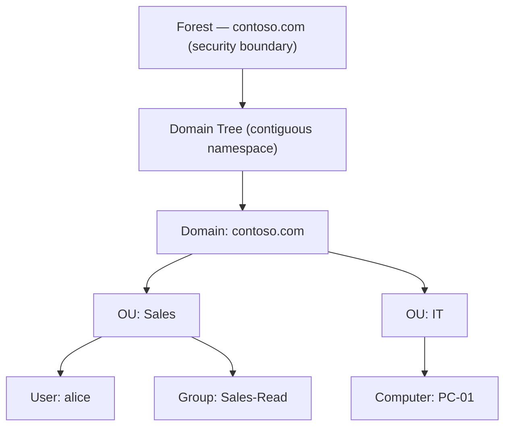
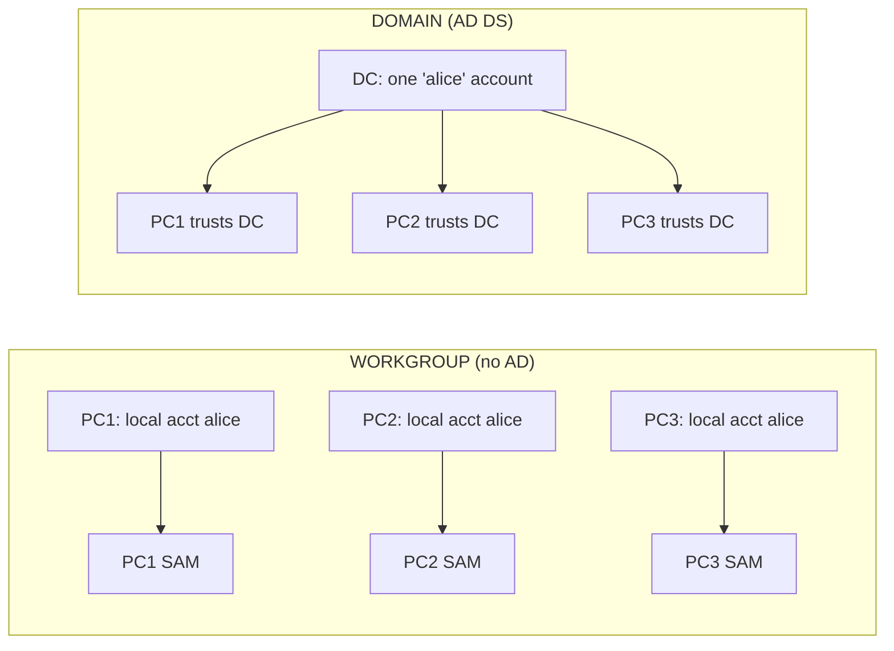
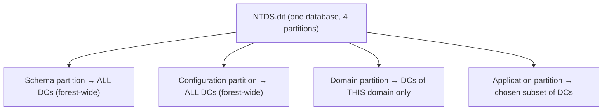
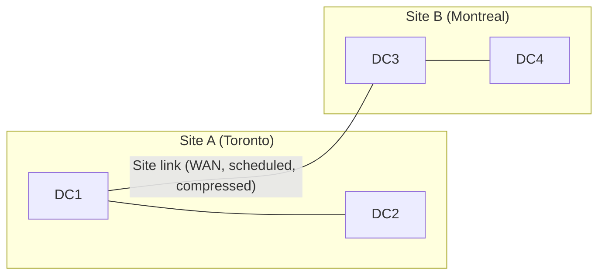
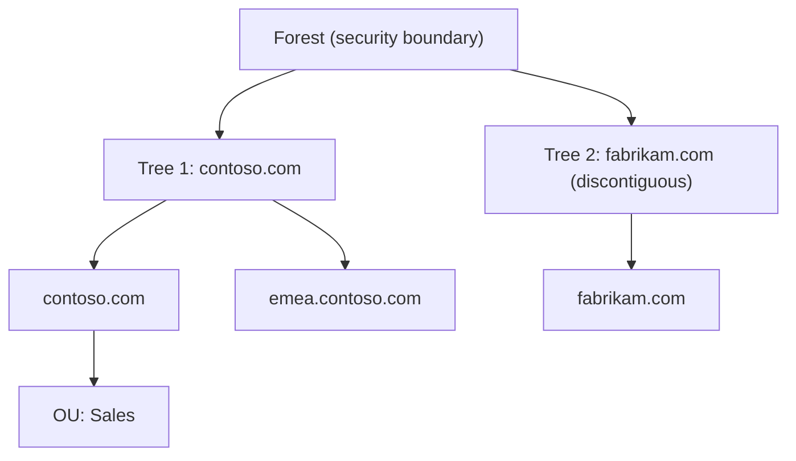
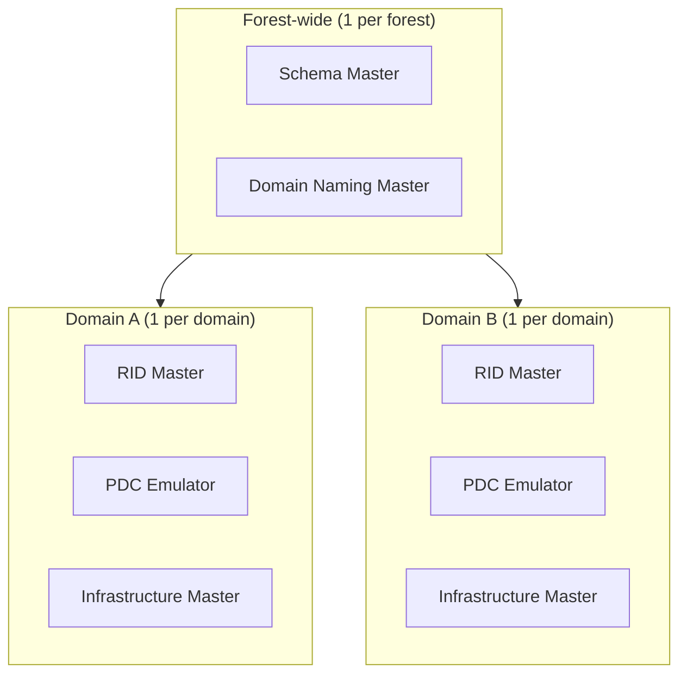
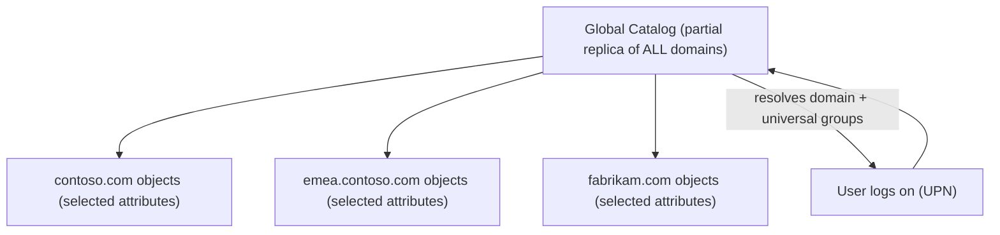
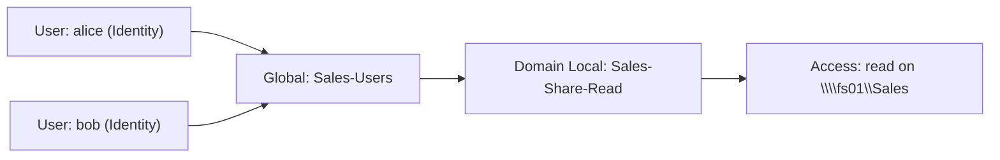

# Active Directory Domain Services (AD DS) — Midterm Notes

> **💡 Key Idea:** AD DS is the dominant cluster on this midterm (roughly 60%+). If you can draw the
> forest/domain/OU hierarchy, name the four database partitions, the five FSMO roles, and explain how
> the Global Catalog helps both **searches and logins**, you own this exam.

## Concept cheat-sheet: easily-confused pairs

| Concept A | Concept B | The distinction that matters |
|---|---|---|
| **Domain** | **Forest** | A domain is a replication + management boundary; a forest is the ultimate **security** boundary (one shared schema + configuration). |
| **Domain Controller (DC)** | **Member server** | A DC runs AD DS and holds a copy of NTDS.dit; a member server is joined to the domain but does **not** run AD DS. |
| **Tree** | **Forest** | A tree = domains with a **contiguous** namespace; a forest = one or more trees (possibly **discontiguous** namespaces). |
| **OU** | **Group** | An OU is a **container** (for delegation + GPO); a group is a **list of principals** (for permissions). |
| **Site** | **Domain** | A site is a **physical** concept (well-connected subnets, usually a location); a domain is a **logical** concept (a security/management boundary). |
| **Intrasite replication** | **Intersite replication** | Intrasite is fast, uncompressed, change-notified (seconds); intersite is compressed and scheduled (minutes/hours) over site links. |
| **Schema partition** | **Domain partition** | Schema partition is **forest-wide** (replicated to all DCs); Domain partition is **domain-wide** (replicated only to that domain's DCs). |
| **FSMO transfer** | **FSMO seize** | Transfer is graceful (both DCs online); seize is forceful (old holder permanently failed). |
| **Global Catalog** | **Schema** | GC is a partial replica of **data** used for search/login; schema is the **rules** defining what data can exist. |
| **IGDLA** | **AGDLP** | Same pattern, different mnemonic: I(Identity)→G(Global)→D(Domain Local)→A(Access) = A(ccounts)→G→DL→P(ermissions). |

---

## Topic 1 — What is AD DS?

### Definition
AD DS (Active Directory Domain Services) is Microsoft's directory service on Windows Server that stores, organizes, and provides access to information about network objects — users, computers, groups, and devices — in a centralized, hierarchical, replicated database, and it both **authenticates** and **authorizes** those objects against domain resources.

### How it works
1. **Data lives in a database (NTDS.dit)** on servers promoted to **domain controllers**, organized as a hierarchy: *forest → domain tree → domain → OU → object*.
2. **Every object has attributes** — a user carries a name, logon ID (`sAMAccountName`), password hash, group memberships, and a unique **SID**.
3. **DNS is the locator** — clients query SRV records (`_ldap._tcp.dc._msdcs.<domain>`) to find a nearby DC. *No DNS = no AD.*
4. **Authentication uses Kerberos** — the DC acts as the Key Distribution Center (KDC) and issues tickets; **NTLM** is the legacy fallback.
5. **Authorization uses ACLs and groups** — resources grant access to SIDs; group membership groups SIDs for convenient granting.
6. **Replication is multi-master** — most changes can be made on any DC and are replicated to the others (with a few single-master exceptions, the FSMO roles).
7. **Global Catalog** provides a partial forest-wide replica for fast searches and logins.

### Key terms

| Term | Meaning |
|---|---|
| Directory service | A database that stores/organizes identity data and provides lookup + authentication |
| Object | Any stored entry: user, computer, group, printer, shared folder |
| Attribute | A property of an object (e.g., `givenName`, `sAMAccountName`) |
| Domain | A logical grouping of objects; a replication and management boundary |
| Domain Controller (DC) | A server running AD DS holding a copy of NTDS.dit |
| Forest | Top-level container and ultimate security boundary |
| SID | Security Identifier — unique ID of a principal, used in ACLs |
| GUID | Globally Unique Identifier — an object's permanent identity, never reused |
| LDAP | The protocol used to query the directory |
| Kerberos | The default authentication protocol (issues tickets via the KDC) |
| Global Catalog | A partial, forest-wide replica enabling cross-domain search/login |

### Diagram



What to notice: the **forest sits at the top** as the security boundary; **OUs nest under the domain**; **users/computers are leaf objects**; **groups** hold principals for permissions while **OUs** hold objects for policy/delegation.

### Example scenario
Contoso has 300 employees. Instead of a local account per PC, the admin promotes a server to a DC, creates the `contoso.com` domain, and makes one `alice` account. Alice logs in once and can access any domain-joined resource she's permitted to — disabling that one account locks her out everywhere.

### Commands and tools

```powershell
Get-ADDomain                     # domain summary (name, forest, DCs)
Get-ADForest                     # forest summary (schema master, domains)
Get-ADDomainController -Filter * # list all DCs
Get-ADUser alice -Properties *   # inspect one user's attributes
```

GUI: **Server Manager → Tools → Active Directory Users and Computers** (`dsa.msc`).

### Exam traps

> **⚠ Exam Trap:** "AD DS is just a database, so DNS isn't required." **Wrong** — AD DS depends on DNS SRV records to locate DCs. The classic question: users can't log in after a DNS change even though DCs are reachable by IP → the clients can no longer resolve the DC locator records.

> **⚠ Exam Trap:** **OU vs Group.** OUs have no SID and cannot be granted file permissions; groups cannot receive a GPO. Questions love swapping these.

> **⚠ Exam Trap:** **NTLM vs Kerberos.** Kerberos = default, tickets, KDC. NTLM = challenge/response fallback. "What protocol does a DC use to issue authentication tickets?" → Kerberos.

### Quick check
1. **Q:** Name the top-to-bottom AD container hierarchy. **A:** Forest → Domain Tree → Domain → OU → Object.
2. **Q:** Which server role hosts both NTDS.dit and the Kerberos KDC? **A:** The domain controller.

---

## Topic 2 — Why do we need domain services in a networked environment?

### Definition
Domain services exist to solve the "identity sprawl" problem: instead of maintaining a separate username/password on every machine (a workgroup), you maintain **one** central identity directory that all domain-joined systems trust.

### How it works (the "why" behind each benefit)
1. **Centralized identity management** — one account per user, created once, usable everywhere. *Why:* eliminates duplicate/orphaned local accounts.
2. **Single sign-on (SSO)** — authenticate once, access many resources. *Why:* Kerberos tickets are reused so users aren't repeatedly prompted.
3. **Central policy via Group Policy** — settings (password policy, lockout, drive mappings) defined once, pushed to OUs. *Why:* consistency and compliance.
4. **Scalable delegation** — admin rights scoped to a single OU. *Why:* a help-desk tech can reset passwords for Sales without being a domain admin.
5. **Fault tolerance** — multiple DCs replicate the directory. *Why:* one DC failing doesn't stop logons.
6. **Security and auditability** — Kerberos, account lockout, password complexity, central logging. *Why:* one place to enforce and inspect access.

### Key terms

| Term | Meaning |
|---|---|
| Workgroup | Peer-to-peer; each machine keeps its own local account database (SAM) |
| Domain | Central identity/security store trusted by all joined machines |
| SAM database | The local account store on a non-domain-joined Windows machine |
| Group Policy | Central configuration/security settings delivery |
| Delegation | Scoping admin rights to a subtree (e.g., one OU) |

### Diagram



What to notice: the workgroup has **three separate password databases**; the domain has **one account** trusted by all three machines — one password, one disable, one audit trail.

### Example scenario
An employee leaves. In a workgroup, IT must touch every machine they used. In a domain, the admin disables **one** account in AD Users and Computers, and access to all domain resources is revoked immediately.

### Commands and tools

```powershell
New-ADUser -Name "Alice Smith" -SamAccountName alice -UserPrincipalName alice@contoso.com `
  -Path "OU=Sales,DC=contoso,DC=com" -AccountPassword (Read-Host -AsSecureString) -Enabled $true
Search-ADAccount -LockedOut   # find locked-out accounts
```

### Exam traps

> **⚠ Exam Trap:** **Local vs domain account** — a local account exists only in a machine's SAM; a domain account works anywhere in the domain. "Which account works on a non-domain-joined server?" → local only.

> **⚠ Exam Trap:** **Group Policy ≠ NTFS permissions.** Group Policy *configures settings*; NTFS/ACLs *control file access*. "Which tool enforces password length?" → Group Policy. "Which grants read access to a folder?" → NTFS + a group.

> **⚠ Exam Trap:** AD DS is **not** a general-purpose relational database like SQL Server — it's an optimized, hierarchical, multi-master directory store.

### Quick check
1. **Q:** Give one concrete reason a 200-PC company adopts AD DS over a workgroup. **A:** One centralized account per user (single password, single disable/audit point) instead of 200 separate local stores.
2. **Q:** Does a member server store a copy of all domain accounts? **A:** No — only domain controllers hold NTDS.dit; member servers rely on DCs for domain authentication.

---

## Topic 3 — AD DS Database Partitions

### Definition
Active Directory stores its data in a database (**NTDS.dit**) that is divided into logical **partitions** (also called *naming contexts*). Each partition is a self-contained unit that is **replicated as a whole** to a defined set of domain controllers.

### How it works
1. **Schema partition** — defines every object **class** and **attribute** the directory may contain. It is **forest-wide**: replicated to **every DC in the forest**.
2. **Configuration partition** — holds the **forest topology**: which domains exist, which sites and site links exist, which DCs exist, and the replication topology. Also **forest-wide**, replicated to every DC.
3. **Domain partition** — holds the **actual objects** for one domain (users, computers, groups, OUs). Replicated **only to DCs in that domain**.
4. **Application partition** — a custom partition created by an application or service for its own data (e.g., DNS application partitions `DomainDnsZones` / `ForestDnsZones`). Replicated to a **scoped subset** of DCs chosen by the admin/application.

### Key terms

| Term | Meaning |
|---|---|
| Partition / naming context | A self-contained, replicated unit of the AD database |
| Schema partition | Defines classes + attributes; forest-wide |
| Configuration partition | Forest topology (domains, sites, DCs); forest-wide |
| Domain partition | One domain's objects; domain-wide |
| Application partition | App-specific data; replicated to a chosen subset of DCs |
| NTDS.dit | The physical AD database file on a DC |

### Diagram



What to notice: **Schema + Configuration** go to *every* DC in the forest; the **Domain** partition stays within its own domain; **Application** partitions go only where configured.

### Example scenario
An admin installs a new application that needs to store settings in AD. The app creates an **application partition** and chooses to replicate it only to the three DCs that serve that app — not the whole forest.

### Commands and tools

```powershell
Get-ADRootDSE | Select-Object schemaNamingContext, configurationNamingContext, defaultNamingContext
Get-ADObject -SearchBase (Get-ADRootDSE).configurationNamingContext -Filter 'ObjectClass -eq "site"'
```

GUI: **ADSI Edit** (`adsiedit.msc`) to browse the Schema, Configuration, and Domain naming contexts directly.

### Exam traps

> **⚠ Exam Trap:** "All partitions replicate to all DCs." **Wrong** — only **Schema and Configuration** are forest-wide. The **Domain** partition is domain-wide, and **Application** partitions go to a scoped subset.

> **⚠ Exam Trap:** Don't confuse the **Configuration partition** (forest topology) with the **Domain partition** (the actual users/groups). "Where are the user objects stored?" → Domain partition. "Where is the site topology stored?" → Configuration partition.

> **⚠ Exam Trap:** A **naming context = partition**. These are synonyms; if a question says "naming context," it means partition.

### Quick check
1. **Q:** Which two partitions are replicated to every DC in the forest? **A:** Schema and Configuration.
2. **Q:** Which partition holds the user/computer/group objects of a single domain? **A:** The Domain partition.

---

## Topic 4 — AD DS Physical Components: Sites & Replication Topology

### Definition
The **physical** structure of AD DS describes where DCs and networks actually *are* — organized into **sites** (groups of well-connected subnets) connected by **site links** — so that replication and authentication can be made **efficient**.

### How it works
1. A **site** is a set of **subnets** on fast, reliable links (usually one physical location/building).
2. **Subnets** are mapped to sites so clients and DCs know which site they belong to.
3. A **site link** connects two sites and represents a (typically slower) WAN link; it has a **cost**, a **schedule**, and a **replication interval**.
4. A **site link bridge** makes site links transitive across intermediate sites.
5. **Replication** behaves differently by location:
   - **Intrasite** (within a site): fast, **uncompressed**, **change-notification** based (seconds), topology auto-built by the **KCC** into a ring.
   - **Intersite** (between sites): **compressed** to save WAN bandwidth, **scheduled** (default 180 min), uses **bridgehead servers**.
6. **Why sites matter for authentication:** a client should log on against a **DC in its own site** (the nearest DC). Sites + subnet mapping tell the client which DC is closest.

### Key terms

| Term | Meaning |
|---|---|
| Site | A group of well-connected subnets (physical location) |
| Subnet | An IP range mapped to a site |
| Site link | A connection between two sites (WAN link, with cost/schedule/interval) |
| Site link bridge | Makes site links transitive |
| KCC | Knowledge Consistency Checker — auto-builds the replication topology |
| Bridgehead server | The DC designated to replicate between sites |
| Intrasite / intersite | Replication within a site vs between sites |

### Diagram



What to notice: within each site, DCs replicate **fast (uncompressed, change-notified)**; between sites, replication crosses a **site link** that is **scheduled and compressed** to conserve WAN bandwidth.

### Example scenario
Contoso has DCs in Toronto and Montreal. The admin defines two **sites**, maps each office's subnets, and connects them with a **site link** set to replicate nightly — so the WAN isn't saturated with replication during business hours, and Montreal users authenticate against Montreal DCs.

### Commands and tools

```powershell
Get-ADReplicationSite                       # list sites
Get-ADReplicationSiteLink                   # list site links (cost, interval)
Get-ADReplicationSubnet                     # list subnet → site mappings
repadmin /showrepl                          # show replication status
```

GUI: **Active Directory Sites and Services** (`dssite.msc`).

### Exam traps

> **⚠ Exam Trap:** **Site (physical) vs Domain (logical).** A site groups *subnets/locations*; a domain groups *objects* for management/security. They are independent — one site can span domains, and one domain can span sites.

> **⚠ Exam Trap:** **Intrasite vs intersite.** Intrasite = uncompressed + change-notified (fast). Intersite = **compressed + scheduled**. Don't say intersite replicates instantly or uncompressed.

> **⚠ Exam Trap:** A client should authenticate to a DC **in its own site** (via subnet→site mapping). "Why isn't my user hitting the local DC?" → the client's **subnet isn't mapped to the correct site**.

### Quick check
1. **Q:** What is the purpose of a site? **A:** To group well-connected subnets so replication and authentication can be made efficient (nearest DC, scheduled/compressed WAN replication).
2. **Q:** How does intrasite replication differ from intersite replication? **A:** Intrasite is fast/uncompressed/change-notified; intersite is compressed and scheduled over site links.

---

## Topic 5 — AD DS Logical Components: Domains, Trees, Forests, OUs

### Definition
The **logical** structure of AD DS defines how objects are organized and managed — through **domains**, grouped into **trees** and **forests**, with **OUs** organizing objects *inside* a domain.

### How it works
1. **Organizational Unit (OU)** — a container *within a domain* for grouping objects. Used for **delegation** (give someone admin over one OU) and **Group Policy** (link a GPO to an OU).
2. **Domain** — a logical grouping of objects sharing a directory database; a **replication** and **management** boundary. Has its own namespace and (domain-wide) policies.
3. **Tree** — a set of domains sharing a **contiguous** namespace (`child.contoso.com` under `contoso.com`), joined by **two-way transitive trusts**.
4. **Forest** — the top-level container and the ultimate **security boundary**. All domains in a forest share **one schema** and **one configuration** partition.

### Key terms

| Term | Meaning |
|---|---|
| OU | Container for delegation + GPO within a domain |
| Domain | Logical grouping; replication + management boundary |
| Tree | Contiguous-namespace domains connected by transitive trusts |
| Forest | Security boundary; shares schema + configuration |
| Trust | A relationship enabling authentication across domains (forest trusts are transitive) |

### Diagram



What to notice: one **forest** can hold multiple **trees** with *discontiguous* namespaces (`contoso.com` + `fabrikam.com`); within a tree, domains share a *contiguous* namespace; OUs live *inside* a domain.

### Example scenario
After an acquisition, Contoso adds `fabrikam.com` as a second **tree** in the same forest — the two namespaces are discontiguous but still share one schema and configuration, and a trust lets users in both trees authenticate across the forest.

### Commands and tools

```powershell
Get-ADDomain       # current domain (name, forest, functional level)
Get-ADForest       # forest (domains, schema master, domain naming master)
Get-ADOrganizationalUnit -Filter *   # list OUs
```

GUI: **Active Directory Domains and Trusts** (`domain.msc`) to view domains and trusts.

### Exam traps

> **⚠ Exam Trap:** **Domain vs Forest** — the forest is the **security** boundary (schema/config shared); the domain is the **replication/management** boundary. "Which is the ultimate security boundary?" → forest.

> **⚠ Exam Trap:** **Tree vs Forest** — a tree requires a **contiguous** namespace; a forest can contain **discontiguous** trees. "Can a forest hold two namespaces like contoso.com and fabrikam.com?" → yes, as separate trees.

> **⚠ Exam Trap:** **OU vs Domain** — OUs nest *inside* domains and are not security boundaries; domains are. Delegation scoped to an OU does not grant forest-wide rights.

### Quick check
1. **Q:** List the logical components from smallest scoping unit to largest. **A:** OU → Domain → Tree → Forest.
2. **Q:** What is shared by all domains in a forest? **A:** One schema and one configuration partition (and transitive trusts).

---

## Topic 6 — FSMO Roles (Flexible Single Master Operations)

### Definition
**FSMO** roles are five special operations in AD DS that must be performed by a **single domain controller** at a time — even though replication is otherwise multi-master — to avoid update conflicts on tasks that can't safely run on two DCs at once.

### How it works
1. AD replication is **multi-master**, but a few operations are **single-master** by design.
2. The five roles split into **two forest-wide** and **three domain-wide**:

| Role | Scope | Function |
|---|---|---|
| **Schema Master** | Forest | All **schema** updates/changes |
| **Domain Naming Master** | Forest | Adding/removing **domains** in the forest |
| **RID Master** | Domain | Hands out **RID pools** to DCs so they can create SIDs |
| **PDC Emulator** | Domain | **Password changes, time sync, account lockout**, legacy NT 4.0 emulation |
| **Infrastructure Master** | Domain | Updates **cross-domain object references** (e.g., group membership) |

3. A forest with `N` domains has **2 + 3N** role holders.
4. The **first DC installed in a forest holds all five** roles by default; the first DC of each *new* domain takes that domain's three roles.
5. Special rule: in a **multi-domain** forest, the **Infrastructure Master should NOT be on a Global Catalog server** (unless *every* DC is a GC), because the GC's data would mask the cross-domain references it's meant to fix.

### Key terms

| Term | Meaning |
|---|---|
| FSMO | Flexible Single Master Operations — the 5 single-master roles |
| Single-master | An operation only one DC may perform at a time |
| RID | Relative Identifier — part of a SID, unique per principal |
| Role holder | The DC currently responsible for a given FSMO role |

### Diagram



What to notice: **two roles once per forest**, **three roles repeat per domain**. A two-domain forest has **2 + 3×2 = 8** role holders.

### Example scenario
Users report that password changes and account lockouts are behaving inconsistently. The admin runs `netdom query fsmo` and confirms the **PDC Emulator** role — the one responsible for password changes and lockout processing — is held by the expected DC.

### Commands and tools

```powershell
netdom query fsmo      # list all 5 roles and their holders
Get-ADForest contoso.com | Select-Object SchemaMaster, DomainNamingMaster
Get-ADDomain contoso.com  | Select-Object RIDMaster, PDCEmulator, InfrastructureMaster
# Transfer a role to DC02
Move-ADDirectoryServerOperationMasterRole -Identity "DC02" -OperationMasterRole PDCEmulator
```

GUI: **AD Users and Computers → right-click domain → Operations Masters** (RID/PDC/Infrastructure).

### Exam traps

> **⚠ Exam Trap:** "There are 5 FSMO roles per domain." **Wrong** — 3 are per-domain; 2 are per-forest. "How many role holders in a 3-domain forest?" → **2 + 3×3 = 11**.

> **⚠ Exam Trap:** **`Get-ADDomain` shows the 3 domain roles; `Get-ADForest` shows the 2 forest roles.** "Which cmdlet shows the Schema Master?" → `Get-ADForest`.

> **⚠ Exam Trap:** **Transfer vs Seize** — transfer needs the old holder **online**; seize is for a **permanently failed** holder (and you must never bring the old DC back). Don't confuse them.

> **⚠ Exam Trap:** **Infrastructure Master + Global Catalog** — in multi-domain forests, don't put the Infrastructure Master on a GC (unless all DCs are GCs).

### Quick check
1. **Q:** Name the two forest-wide and three domain-wide FSMO roles. **A:** Forest: Schema Master, Domain Naming Master. Domain: RID Master, PDC Emulator, Infrastructure Master.
2. **Q:** A forest has 4 domains. How many FSMO role holders? **A:** 2 + (3×4) = **14**.

---

## Topic 7 — Global Catalog (GC)

### Definition
The **Global Catalog** is a **partial, read-only replica** of every domain in the forest. It contains a copy of *every object* but only a **subset of its attributes** (those marked for GC inclusion), and it is used to answer forest-wide **searches** and to facilitate **logins**.

### How it works
1. Any DC can be designated a **GC server** (the first DC in a forest is a GC by default).
2. The GC holds **all objects** from **all domains**, but only **commonly-needed attributes** (e.g., `displayName`, email, `userPrincipalName`, **universal group memberships**).
3. **Role 1 — Searches:** a forest-wide query (e.g., "find this user's email") is answered by the local GC without contacting every domain.
4. **Role 2 — Logins:** when a user logs on with a **UPN** (`user@contoso.com`), the GC can resolve **which domain** the account lives in. The GC also supplies the user's **universal group membership** so the security token is complete.
5. **Consequence:** in a **multi-domain forest**, if the GC is **unavailable**, ordinary users **cannot log on** (their universal group membership can't be enumerated). Members of **Domain Admins** can still log on (a built-in fallback).

### Key terms

| Term | Meaning |
|---|---|
| Global Catalog | Partial, read-only, forest-wide replica of all objects |
| GC server | A DC configured to host the Global Catalog |
| UPN | User Principal Name (`user@domain`) used at logon |
| Universal group | A group whose membership is stored in the GC (forest-wide) |
| Partial attribute set | The subset of attributes replicated into the GC |

### Diagram



What to notice: the GC aggregates **partial** data from **every domain**, so a single query or a logon can be resolved without round-tripping to each domain.

### Example scenario
A user in Domain A logs in with their UPN and needs to access resources in Domain B. The GC resolves which domain the account is in and supplies the user's **universal group memberships**, so the access token is complete and correct across the forest.

### Commands and tools

```powershell
Get-ADDomainController -Filter {IsGlobalCatalog -eq $true}   # list GC servers
```

GUI: **Active Directory Sites and Services → site → Servers → DC → NTDS Settings → Properties → Global Catalog** checkbox.

### Exam traps

> **⚠ Exam Trap:** "The GC stores a *full* copy of every object." **Wrong** — it stores every object but only a **subset of attributes** (the partial attribute set).

> **⚠ Exam Trap:** **GC's two jobs — searches AND logins.** Many students remember only "searches." In a multi-domain forest, **logins depend on the GC** for universal-group membership. "What happens if the GC is down in a multi-domain forest?" → ordinary users can't log on (Domain Admins still can).

> **⚠ Exam Trap:** **GC vs Infrastructure Master** — the GC is a data replica; the Infrastructure Master updates cross-domain references. Don't conflate them (and remember the "don't place IM on a GC" rule).

### Quick check
1. **Q:** What are the two roles of the Global Catalog? **A:** (1) enabling forest-wide searches; (2) facilitating logins (UPN resolution + universal group membership).
2. **Q:** True or false — the GC holds a full copy of every attribute of every object. **A:** False — it holds every object but only a subset of attributes.

---

## Topic 8 — IGDLA Model

### Definition
**IGDLA** is a structured, scalable permission model: **I**dentity → **G**lobal group → **D**omain **L**ocal group → **A**ccess. It organizes accounts into groups and grants access at a single point, so permissions stay manageable as the environment grows.

### How it works
1. **I — Identity:** the user **accounts** (the people).
2. **G — Global group:** group accounts **by role/department** *within their own domain* (e.g., "Sales-Users"). Global groups can only contain accounts from their own domain.
3. **D — Domain Local group:** group **resource access** *within a domain* (e.g., "Sales-Share-Read"). This is the group you actually grant permissions to.
4. **A — Access (permissions):** assigned to the **Domain Local** group, not directly to users.
5. **Multi-domain extension (I-G-U-DL-A):** insert a **Universal** group between Global and Domain Local to bridge accounts from *different domains* into one Domain Local group.

### Key terms

| Term | Meaning |
|---|---|
| IGDLA | Identity → Global → Domain Local → Access (the permission model) |
| Identity | User accounts |
| Global group | Groups users by role within their own domain |
| Domain Local group | Represents resource access; receives the permissions |
| Access | The actual permission granted to the Domain Local group |
| Universal group | (Multi-domain) bridges Global groups across domains |

### Diagram



What to notice: users go into a **Global** group, that Global group goes into a **Domain Local** group, and **only the Domain Local group** gets the permission — a single, consistent place to manage access.

### Example scenario
Sales adds 10 new hires. Instead of editing the share ACL 10 times, the admin adds the 10 accounts to the **Global group "Sales-Users"**; the **Domain Local group "Sales-Share-Read"** already holds read access, so nothing else changes.

### Commands and tools

```powershell
New-ADGroup -Name "Sales-Users" -GroupScope Global      -GroupCategory Security
New-ADGroup -Name "Sales-Read"  -GroupScope DomainLocal -GroupCategory Security
Add-ADGroupMember -Identity "Sales-Users" -Members alice, bob
Add-ADGroupMember -Identity "Sales-Read"  -Members "Sales-Users"
```

### Exam traps

> **⚠ Exam Trap:** **IGDLA = AGDLP.** They're the *same* pattern — I(Identity) vs A(ccounts), A(ccess) vs P(ermissions). Don't treat them as different models; your teacher uses **IGDLA**.

> **⚠ Exam Trap:** Nesting direction is one-way: **Global into Domain Local**, never the reverse. A Domain Local group cannot be a member of a Global group.

> **⚠ Exam Trap:** "Add users directly to the Domain Local group." Technically possible, but it breaks IGDLA. The *best-practice* answer routes **Global groups** into the **Domain Local** group.

> **⚠ Exam Trap:** For **multi-domain** forests, add a **Universal** group (I-G-U-DL-A) — but use Universal groups sparingly (their membership replicates forest-wide in the GC).

### Quick check
1. **Q:** What does each letter of IGDLA stand for? **A:** Identity → Global → Domain Local → Access.
2. **Q:** When do you insert a Universal group into the chain? **A:** In a multi-domain forest, to bridge Global groups from different domains into one Domain Local group.
