# Windows Server Midterm — Complete Study Notes

> **💡 Key Idea:** This is the full midterm scope (Modules 3–6). **AD DS** (5 lectures) is ~60% of the exam;
> **Storage** (2 lectures) and **Hyper-V** (1 lecture) share the rest. Weeks 1–2 (hardware, installation) are
> **not** on the midterm. Focus on the *differences* between easily-confused concepts — that's what gets tested.

## Master cheat-sheet: easily-confused pairs

| Concept A | Concept B | The distinction that matters |
|---|---|---|
| **Domain** | **Forest** | Domain = replication + management boundary; forest = ultimate **security** boundary (one shared schema + config). |
| **DC** | **Member server** | A DC runs AD DS (holds NTDS.dit); a member server is joined but does **not** run AD DS. |
| **Site** | **Domain** | Site = **physical** (well-connected subnets); domain = **logical** (security/management boundary). |
| **Intrasite replication** | **Intersite replication** | Intrasite = fast/uncompressed/change-notified; intersite = compressed + scheduled over site links. |
| **Schema partition** | **Domain partition** | Schema = **forest-wide**; Domain = **domain-wide** (replication boundary). |
| **SID** | **GUID** | SID = used for **authorization** (ACLs); GUID = permanent **object identity** (never reused). |
| **FSMO transfer** | **FSMO seize** | Transfer = graceful (both DCs online); seize = forceful (old holder dead). |
| **Global Catalog** | **Schema** | GC = partial replica of **data** (search/login); schema = the **rules** defining data. |
| **IGDLA** | **AGDLP** | Same pattern, different mnemonic: I→G→DL→A = A→G→DL→P. |
| **Type 1 hypervisor** | **Type 2 hypervisor** | Type 1 = bare-metal (on hardware); Type 2 = hosted (on a host OS). |
| **Internal switch** | **Private switch** | Internal includes the **host**; Private is **VMs only**. |
| **Standard checkpoint** | **Production checkpoint** | Standard = memory + crash-consistent; Production = VSS/app-consistent, no memory. |
| **iSCSI target** | **iSCSI initiator** | Target **provides** the LUNs; initiator **connects to** them. |
| **Storage Pool** | **Storage Space** | Pool = group of **physical disks**; Space = the **virtual disk** carved from it. |
| **DAS** | **NAS** | DAS = direct-attached (block, one server); NAS = file-level over SMB/NFS. |
| **NAS** | **SAN** | NAS = **file-level** (SMB/NFS); SAN = **block-level** (iSCSI/Fibre Channel). |
| **RAID 0** | **RAID 1** | RAID 0 = striping, **no redundancy**; RAID 1 = mirroring (redundant). |
| **RAID 5** | **RAID 10** | RAID 5 = parity (3 disks, 1 failure); RAID 10 = mirror+stripe (4 disks, faster). |

---

## AD DS (Active Directory Domain Services) — 9 topics

### Topic 1 — What is AD DS?

#### Definition
AD DS (Active Directory Domain Services) is Microsoft's directory service on Windows Server that stores, organizes, and provides access to information about network objects — users, computers, groups — in a centralized, hierarchical, replicated database, and it both **authenticates** and **authorizes** those objects against domain resources.

#### How it works
1. **Data lives in NTDS.dit** on **domain controllers**, organized as *forest → domain tree → domain → OU → object*.
2. **Every object has attributes** (name, logon ID, password hash, group membership, and a unique **SID**).
3. **DNS is the locator** — clients query SRV records (`_ldap._tcp.dc._msdcs.<domain>`) to find a DC. *No DNS = no AD.*
4. **Authentication uses Kerberos** — the DC acts as the KDC and issues tickets; NTLM is the legacy fallback.
5. **Authorization uses ACLs and groups** — resources grant access to SIDs; groups bundle SIDs for convenient granting.
6. **Replication is multi-master** (with a few single-master exceptions — the FSMO roles).
7. **Global Catalog** provides a partial forest-wide replica for fast searches and logins.

#### Key terms

| Term | Meaning |
|---|---|
| Directory service | A database storing identity data + providing lookup and authentication |
| Object | Any stored entry: user, computer, group, printer |
| Attribute | A property of an object (e.g., `sAMAccountName`) |
| Domain | Logical grouping; replication + management boundary |
| Domain Controller (DC) | A server running AD DS holding a copy of NTDS.dit |
| Forest | Top-level container; ultimate security boundary |
| SID | Security Identifier — unique principal ID used in ACLs |
| GUID | Globally Unique Identifier — permanent object identity |
| LDAP | Protocol used to query the directory |
| Kerberos | Default authentication protocol (tickets via the KDC) |

#### Diagram

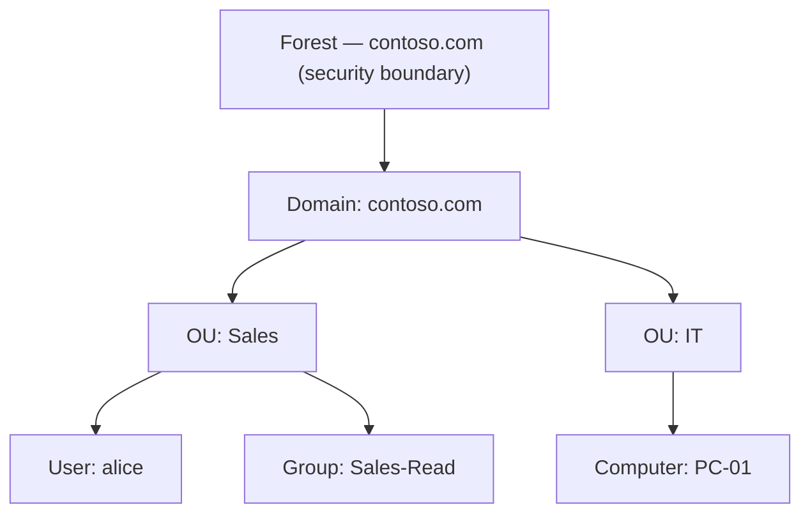

What to notice: forest at top = security boundary; OUs nest under the domain; users/computers are leaf objects; groups hold principals for permissions while OUs hold objects for policy/delegation.

#### Example scenario
Contoso has 300 employees. Instead of a local account per PC, the admin promotes a server to a DC, creates the `contoso.com` domain, and makes one `alice` account — one logon, one disable, one audit trail.

#### Commands and tools

```powershell
Get-ADDomain                     # domain summary
Get-ADForest                     # forest summary
Get-ADDomainController -Filter * # list DCs
Get-ADUser alice -Properties *   # inspect one user
```

GUI: **Server Manager → Tools → Active Directory Users and Computers** (`dsa.msc`).

#### Exam traps

> **⚠ Exam Trap:** "AD DS is just a database, so DNS isn't required." **Wrong** — AD DS depends on DNS SRV records to locate DCs. Users can't log in after a DNS change even though DCs are reachable by IP.

> **⚠ Exam Trap:** **OU vs Group.** OUs have no SID and can't be granted file permissions; groups can't receive a GPO.

> **⚠ Exam Trap:** **Kerberos vs NTLM.** Kerberos = default, tickets, KDC. NTLM = challenge/response fallback.

#### Quick check
1. **Q:** Name the top-to-bottom AD hierarchy. **A:** Forest → Domain Tree → Domain → OU → Object.
2. **Q:** Which server hosts both NTDS.dit and the KDC? **A:** The domain controller.

### Topic 2 — Why do we need domain services?

#### Definition
Domain services solve "identity sprawl": instead of a separate username/password on every machine (workgroup), you maintain **one** central identity directory that all domain-joined systems trust.

#### How it works (the "why")
1. **Centralized identity** — one account per user, created once. *Why:* eliminates duplicate/orphaned local accounts.
2. **Single sign-on** — authenticate once, access many resources. *Why:* Kerberos tickets are reused.
3. **Group Policy** — settings defined once, pushed to OUs. *Why:* consistency and compliance.
4. **Delegation** — admin rights scoped to one OU. *Why:* help-desk can reset Sales passwords without being domain admin.
5. **Fault tolerance** — multiple DCs replicate. *Why:* one DC failing doesn't stop logons.
6. **Security/auditability** — Kerberos, lockout, central logging. *Why:* one place to enforce access.

#### Key terms

| Term | Meaning |
|---|---|
| Workgroup | Peer-to-peer; each machine keeps its own SAM |
| Domain | Central identity store trusted by all joined machines |
| SAM | Local account database on a non-domain-joined machine |
| Group Policy | Central configuration/security delivery |
| Delegation | Scoping admin rights to a subtree |

#### Diagram

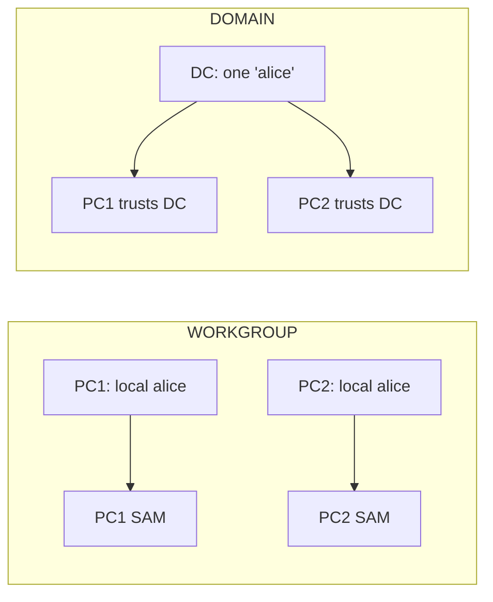

What to notice: workgroup = many password databases; domain = one account trusted by all.

#### Example scenario
An employee leaves. Workgroup: touch every machine. Domain: disable **one** account and access everywhere is revoked.

#### Commands and tools

```powershell
New-ADUser -Name "Alice Smith" -SamAccountName alice -UserPrincipalName alice@contoso.com `
  -Path "OU=Sales,DC=contoso,DC=com" -AccountPassword (Read-Host -AsSecureString) -Enabled $true
Search-ADAccount -LockedOut
```

#### Exam traps

> **⚠ Exam Trap:** **Local vs domain account** — local exists only in a machine's SAM; domain works anywhere in the domain.

> **⚠ Exam Trap:** **Group Policy ≠ NTFS permissions** — GPO *configures settings*; ACLs *control file access*.

> **⚠ Exam Trap:** AD DS is **not** a relational DB like SQL Server — it's a hierarchical, multi-master directory.

#### Quick check
1. **Q:** Why would a 200-PC company adopt AD DS? **A:** One centralized account per user instead of 200 local stores.
2. **Q:** Does a member server store all domain accounts? **A:** No — only DCs hold NTDS.dit.

### Topic 3 — AD DS Database Partitions

#### Definition
AD stores data in **NTDS.dit**, divided into logical **partitions** (naming contexts), each replicated as a whole to a defined set of DCs.

#### How it works
1. **Schema partition** — defines object classes + attributes; **forest-wide**.
2. **Configuration partition** — forest topology (domains, sites, DCs, replication topology); **forest-wide**.
3. **Domain partition** — one domain's objects (users, computers, groups, OUs); **domain-only**.
4. **Application partition** — app-specific data (e.g., `DomainDnsZones`, `ForestDnsZones`); replicated to a **scoped subset**.

#### Key terms

| Term | Meaning |
|---|---|
| Partition / naming context | A self-contained replicated unit of the AD database |
| Schema partition | Classes + attributes; forest-wide |
| Configuration partition | Forest topology; forest-wide |
| Domain partition | One domain's objects; domain-wide |
| Application partition | App data; scoped subset of DCs |
| NTDS.dit | The physical AD database file |

#### Diagram

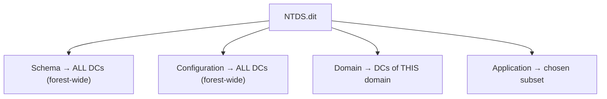

What to notice: Schema + Configuration go to every DC; Domain stays in its domain; Application goes where configured.

#### Example scenario
An app needs to store settings in AD; it creates an **application partition** replicated only to the DCs serving that app.

#### Commands and tools

```powershell
Get-ADRootDSE | Select-Object schemaNamingContext, configurationNamingContext, defaultNamingContext
```

GUI: **ADSI Edit** (`adsiedit.msc`).

#### Exam traps

> **⚠ Exam Trap:** "All partitions replicate to all DCs." **Wrong** — only Schema + Configuration are forest-wide.

> **⚠ Exam Trap:** **Configuration** (topology) vs **Domain** (users/groups). "Where are user objects?" → Domain. "Where is site topology?" → Configuration.

> **⚠ Exam Trap:** **Naming context = partition.** Synonyms.

#### Quick check
1. **Q:** Which two partitions are forest-wide? **A:** Schema and Configuration.
2. **Q:** Which partition holds one domain's users/groups? **A:** Domain partition.

### Topic 4 — Physical Components: Sites & Replication Topology

#### Definition
The **physical** structure groups DCs into **sites** (well-connected subnets) joined by **site links**, so replication and authentication can be efficient.

#### How it works
1. A **site** = a set of subnets on fast, reliable links (usually one location).
2. **Subnets** are mapped to sites so clients/DCs know their site.
3. A **site link** connects two sites (WAN link) with a **cost**, **schedule**, and **replication interval**.
4. **Replication:** **intrasite** = fast, uncompressed, change-notified (seconds), KCC-built ring; **intersite** = compressed, scheduled (default 180 min), uses bridgehead servers.
5. **Why sites matter:** a client logs on against a **DC in its own site** (nearest DC), via subnet→site mapping.

#### Key terms

| Term | Meaning |
|---|---|
| Site | Group of well-connected subnets |
| Subnet | IP range mapped to a site |
| Site link | Connection between sites (WAN, cost/schedule/interval) |
| KCC | Knowledge Consistency Checker — builds replication topology |
| Bridgehead server | DC designated to replicate between sites |

#### Diagram

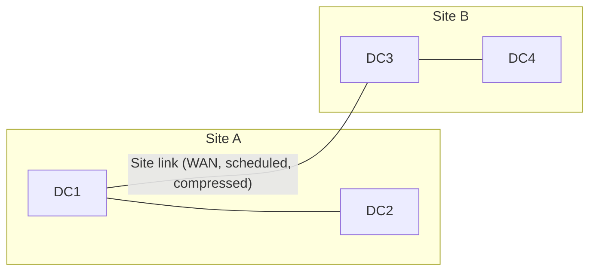

What to notice: within a site replication is fast/uncompressed; between sites it's scheduled/compressed.

#### Example scenario
Contoso has DCs in Toronto and Montreal. Two sites, subnet-mapped, joined by a nightly site link — WAN isn't saturated during business hours, and Montreal users hit Montreal DCs.

#### Commands and tools

```powershell
Get-ADReplicationSite
Get-ADReplicationSiteLink
Get-ADReplicationSubnet
repadmin /showrepl
```

GUI: **Active Directory Sites and Services** (`dssite.msc`).

#### Exam traps

> **⚠ Exam Trap:** **Site (physical) vs Domain (logical)** — independent; a site can span domains and a domain can span sites.

> **⚠ Exam Trap:** **Intrasite vs intersite** — intrasite = uncompressed/change-notified; intersite = compressed/scheduled.

> **⚠ Exam Trap:** A client hitting a remote DC → its **subnet isn't mapped to the correct site**.

#### Quick check
1. **Q:** What is a site for? **A:** Grouping well-connected subnets for efficient replication + nearest-DC authentication.
2. **Q:** Intrasite vs intersite replication? **A:** Intrasite = fast/uncompressed; intersite = compressed/scheduled.

### Topic 5 — Logical Components: Domains, Trees, Forests, OUs

#### Definition
The **logical** structure defines how objects are organized — through **domains**, grouped into **trees** and **forests**, with **OUs** organizing objects inside a domain.

#### How it works
1. **OU** — container within a domain; used for **delegation** and **Group Policy**.
2. **Domain** — logical grouping sharing a directory database; a **replication** + **management** boundary.
3. **Tree** — domains sharing a **contiguous** namespace (`child.contoso.com` under `contoso.com`), joined by transitive trusts.
4. **Forest** — top-level container and ultimate **security boundary**; all domains share **one schema + one configuration**.

#### Key terms

| Term | Meaning |
|---|---|
| OU | Container for delegation + GPO |
| Domain | Logical grouping; replication/management boundary |
| Tree | Contiguous-namespace domains, transitive trusts |
| Forest | Security boundary; shares schema + configuration |

#### Diagram

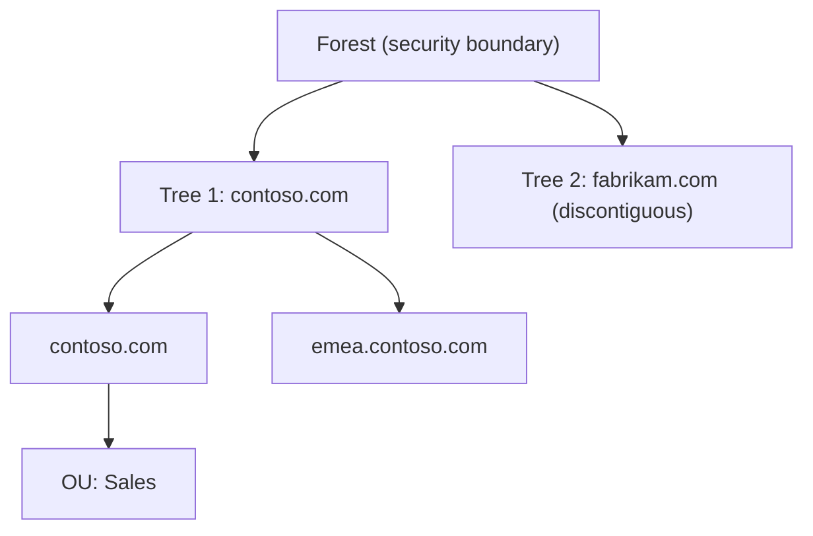

What to notice: one forest can hold multiple **discontiguous** trees; OUs live inside a domain.

#### Example scenario
After an acquisition, `fabrikam.com` becomes a second **tree** in the same forest — discontiguous namespace, but one shared schema + config.

#### Commands and tools

```powershell
Get-ADDomain
Get-ADForest
Get-ADOrganizationalUnit -Filter *
```

GUI: **Active Directory Domains and Trusts** (`domain.msc`).

#### Exam traps

> **⚠ Exam Trap:** **Domain vs Forest** — forest = security boundary; domain = replication/management boundary.

> **⚠ Exam Trap:** **Tree vs Forest** — tree needs contiguous namespace; forest can hold discontiguous trees.

> **⚠ Exam Trap:** OUs are **not** security boundaries; delegating to an OU does not grant forest-wide rights.

#### Quick check
1. **Q:** Smallest-to-largest logical units? **A:** OU → Domain → Tree → Forest.
2. **Q:** What do all domains in a forest share? **A:** One schema + one configuration partition.

### Topic 6 — FSMO Roles (Flexible Single Master Operations)

#### Definition
**FSMO** roles are five operations that must be performed by a **single DC** at a time — even though replication is otherwise multi-master — to avoid update conflicts.

#### How it works
1. AD replication is multi-master, but a few operations are single-master by design.
2. Two forest-wide + three domain-wide roles:

| Role | Scope | Function |
|---|---|---|
| **Schema Master** | Forest | All schema changes |
| **Domain Naming Master** | Forest | Add/remove domains |
| **RID Master** | Domain | Hands out RID pools for SID creation |
| **PDC Emulator** | Domain | Password changes, time sync, lockouts, legacy NT |
| **Infrastructure Master** | Domain | Cross-domain object references |

3. A forest with `N` domains has **2 + 3N** role holders.
4. The first DC in a forest holds **all five**; each new domain's first DC takes its three.
5. Rule: in a multi-domain forest, don't put the **Infrastructure Master on a GC** (unless all DCs are GCs).

#### Key terms

| Term | Meaning |
|---|---|
| FSMO | Flexible Single Master Operations |
| Single-master | An operation only one DC performs |
| RID | Relative Identifier — part of a SID |
| Role holder | The DC responsible for a given role |

#### Diagram

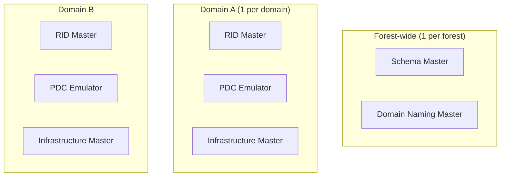

What to notice: two roles per forest, three per domain. A two-domain forest = **2 + 3×2 = 8** holders.

#### Example scenario
Password changes and lockouts behave inconsistently → `netdom query fsmo` confirms the **PDC Emulator** holder is the wrong/expected DC.

#### Commands and tools

```powershell
netdom query fsmo
Get-ADForest contoso.com | Select-Object SchemaMaster, DomainNamingMaster
Get-ADDomain contoso.com  | Select-Object RIDMaster, PDCEmulator, InfrastructureMaster
Move-ADDirectoryServerOperationMasterRole -Identity "DC02" -OperationMasterRole PDCEmulator
```

GUI: **AD Users and Computers → right-click domain → Operations Masters**.

#### Exam traps

> **⚠ Exam Trap:** "5 roles per domain." **Wrong** — 3 per domain, 2 per forest. 3-domain forest → **2 + 3×3 = 11**.

> **⚠ Exam Trap:** `Get-ADDomain` shows the 3 domain roles; `Get-ADForest` shows the 2 forest roles.

> **⚠ Exam Trap:** **Transfer vs Seize** — transfer = both online; seize = old holder permanently failed (never bring it back).

> **⚠ Exam Trap:** Infrastructure Master should **not** sit on a GC in a multi-domain forest.

#### Quick check
1. **Q:** Two forest + three domain roles? **A:** Forest: Schema, Domain Naming. Domain: RID, PDC Emulator, Infrastructure.
2. **Q:** 4-domain forest → how many holders? **A:** 2 + 3×4 = **14**.

### Topic 7 — Global Catalog (GC)

#### Definition
The **Global Catalog** is a **partial, read-only replica** of every domain — every object but only a **subset of attributes** — used for forest-wide **searches** and **logins**.

#### How it works
1. Any DC can be a **GC server** (first DC in a forest is GC by default).
2. The GC holds all objects from all domains, but only the **partial attribute set** (displayName, email, UPN, universal group memberships).
3. **Role 1 — Searches:** a forest-wide query resolves locally without contacting every domain.
4. **Role 2 — Logins:** resolves which domain a UPN account lives in + supplies **universal group membership** for the token.
5. In a multi-domain forest, if the GC is **down**, ordinary users **cannot log on** (universal membership can't be enumerated) — but Domain Admins can.

#### Key terms

| Term | Meaning |
|---|---|
| Global Catalog | Partial, forest-wide, read-only replica |
| GC server | A DC hosting the GC |
| UPN | User Principal Name (`user@domain`) |
| Universal group | Group whose membership is stored in the GC |
| Partial attribute set | The attribute subset replicated into the GC |

#### Diagram

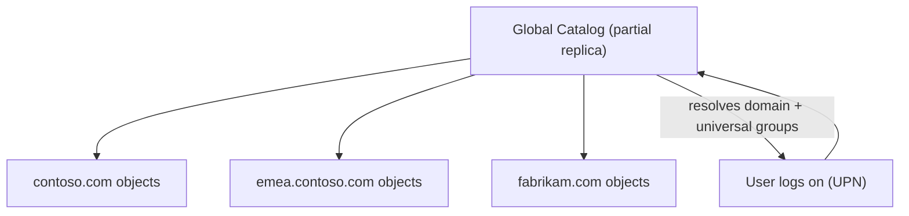

What to notice: the GC aggregates partial data from every domain so a search or logon resolves without round-tripping each domain.

#### Example scenario
A user in Domain A logs on with a UPN and accesses Domain B resources — the GC resolves the domain and supplies universal-group memberships for a complete access token.

#### Commands and tools

```powershell
Get-ADDomainController -Filter {IsGlobalCatalog -eq $true}
```

GUI: **Sites and Services → DC → NTDS Settings → Properties → Global Catalog**.

#### Exam traps

> **⚠ Exam Trap:** "GC stores a full copy of every object." **Wrong** — every object but only a **subset of attributes**.

> **⚠ Exam Trap:** GC has **two jobs — searches AND logins**. GC down in multi-domain forest → ordinary users can't log on.

> **⚠ Exam Trap:** GC (data replica) vs Infrastructure Master (cross-domain references) — don't conflate.

#### Quick check
1. **Q:** Two roles of the GC? **A:** Forest-wide searches + logins (UPN resolution + universal-group membership).
2. **Q:** Does the GC hold a full copy of every attribute? **A:** No — a subset (partial attribute set).

### Topic 8 — IGDLA Model

#### Definition
**IGDLA** is a structured, scalable permission model: **I**dentity → **G**lobal group → **D**omain **L**ocal group → **A**ccess.

#### How it works
1. **I — Identity:** user accounts.
2. **G — Global group:** group accounts by role/department *within their own domain*.
3. **D — Domain Local group:** represents resource access; receives permissions.
4. **A — Access:** permissions granted to the Domain Local group, not to users directly.
5. **Multi-domain (I-G-U-DL-A):** insert a **Universal** group to bridge Global groups across domains.

#### Key terms

| Term | Meaning |
|---|---|
| IGDLA | Identity → Global → Domain Local → Access |
| Global group | Roles within own domain |
| Domain Local group | Resource access; gets the permissions |
| Universal group | Bridges Global groups across domains |

#### Diagram

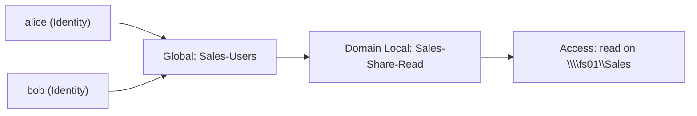

What to notice: users → Global → Domain Local → permission; only the Domain Local group gets the ACL.

#### Example scenario
Sales adds 10 hires. Add them to the **Global "Sales-Users"**; the **Domain Local "Sales-Share-Read"** already holds access — nothing else changes.

#### Commands and tools

```powershell
New-ADGroup -Name "Sales-Users" -GroupScope Global      -GroupCategory Security
New-ADGroup -Name "Sales-Read"  -GroupScope DomainLocal -GroupCategory Security
Add-ADGroupMember -Identity "Sales-Users" -Members alice, bob
Add-ADGroupMember -Identity "Sales-Read"  -Members "Sales-Users"
```

#### Exam traps

> **⚠ Exam Trap:** **IGDLA = AGDLP.** Same pattern, different letters (Identity vs Accounts, Access vs Permissions).

> **⚠ Exam Trap:** Nesting is one-way — **Global into Domain Local**, never reverse.

> **⚠ Exam Trap:** Best practice routes **Global groups** into the **Domain Local** group; don't add users directly to DL.

> **⚠ Exam Trap:** Multi-domain → add **Universal** (I-G-U-DL-A), but use Universal sparingly (GC replication).

#### Quick check
1. **Q:** IGDLA letters? **A:** Identity → Global → Domain Local → Access.
2. **Q:** When to insert Universal? **A:** Multi-domain forests, to bridge Global groups across domains.

### Topic 9 — Security Identifier (SID)

#### Definition
A **Security Identifier (SID)** is a unique, immutable binary identifier that Windows assigns to every **security principal** (user, group, computer). Windows performs all authorization against SIDs — **never** against human-readable names.

#### How it works
1. Every account/group/computer gets a SID at creation, stored in its `objectSID` attribute.
2. **Structure:** `S-1-5-21-<domain-identifier>-<RID>`. The `S-1-5-21-…` prefix identifies the domain (or a "well-known" built-in principal); the trailing **RID** (Relative Identifier) is unique within that domain.
3. The **RID Master** FSMO role issues **RID pools** to DCs so each DC can mint unique SIDs without colliding.
4. **Authorization:** ACLs store SID→permission pairs. A user's access token carries their SID + all group SIDs; the resource's ACL is checked against those SIDs.
5. **Why it matters:** renaming a user keeps the same SID (permissions follow); deleting + recreating gives a **new** SID (old permissions are lost).

#### Key terms

| Term | Meaning |
|---|---|
| SID | Security Identifier — unique ID used in ACLs |
| RID | Relative Identifier — unique part within a domain |
| Security principal | Anything that can be granted access (user, group, computer) |
| ACL | Access Control List — SID→permission pairs |
| Access token | The list of SIDs a user carries at logon |
| Well-known SID | Built-in principals (e.g., S-1-5-18 Local System) |

#### Diagram

```text
S-1-5-21- 1234567890 - 500
 |  |  |    |           |
 |  |  |    |           └── RID (500 = built-in Administrator)
 |  |  |    └── Domain identifier
 |  |  └── authority (5 = SECURITY_NT_AUTHORITY)
 |  └── revision
 └── "S" for SID
```

What to notice: the SID's identity comes from the **domain identifier + RID**; the RID is what makes each principal unique within the domain.

#### Example scenario
An admin deletes and recreates a user with the identical name. The recreated user loses access to their old files because a **new SID** was assigned — the old ACLs still reference the previous SID.

#### Commands and tools

```powershell
whoami /user                              # your own SID
Get-ADUser alice -Properties SID          # a user's SID
Get-ADUser -Identity alice | Select-Object SID
```

#### Exam traps

> **⚠ Exam Trap:** **SID vs GUID.** SID = authorization (ACLs); GUID = permanent object identity (never reused). A recreated user gets a **new SID** but the GUID of the old object is still gone.

> **⚠ Exam Trap:** Renaming a user does **not** change the SID — permissions follow the name change.

> **⚠ Exam Trap:** The **RID Master** FSMO role supplies RID pools; if it's offline, new SID creation eventually stops once pools drain.

#### Quick check
1. **Q:** Why does a deleted-and-recreated user lose old file access? **A:** A new SID is assigned; old ACLs reference the previous SID.
2. **Q:** Which FSMO role supplies the RIDs used to build SIDs? **A:** The RID Master.

---

## Hyper-V & Hypervisors — 3 topics

### Topic 1 — What is Hyper-V? (and hypervisor types)

#### Definition
**Hyper-V** is Microsoft's built-in **hypervisor** for Windows Server/client that runs multiple isolated **VMs** on one host, each with its own virtual CPU, memory, disk, and OS.

#### How it works
1. The hypervisor sits between hardware and guest OSes, scheduling vCPUs and mapping virtual resources.
2. Each VM gets virtual hardware (vCPU, vRAM, `.vhdx` disk) the guest sees as real.
3. Hyper-V is **Type 1 (bare-metal)**: enabling it puts the hypervisor *beneath* Windows.
4. **Type 2 (hosted)** hypervisors (VirtualBox, VMware Workstation) run as an app on a host OS.

#### Key terms

| Term | Meaning |
|---|---|
| Hypervisor | Software layer creating/running VMs |
| VM | Software emulation of a computer |
| Guest OS | OS inside a VM |
| Bare-metal | Running directly on hardware |
| `.vhdx` | Hyper-V virtual disk format |

#### Diagram

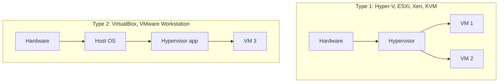

What to notice: Type 1 talks directly to hardware (efficient/secure); Type 2 goes through a host OS (convenient).

#### Example scenario
An IT dept runs 10 workloads on 2 physical hosts via **Hyper-V (Type 1)** — saving hardware, power, and space while isolating workloads.

#### Commands and tools

```powershell
Install-WindowsFeature -Name Hyper-V -IncludeManagementTools -Restart
Get-VM
New-VM -Name "Web01" -MemoryStartupBytes 4GB -NewVHDPath "C:\VMs\Web01.vhdx" -NewVHDSizeBytes 80GB
```

#### Exam traps

> **⚠ Exam Trap:** "Hyper-V on Windows 10/11 is Type 2." **Wrong** — enabling it makes Windows run *under* the hypervisor, so it's Type 1.

> **⚠ Exam Trap:** Type 1 advantages = performance/isolation/security; Type 2 advantage = convenience.

#### Quick check
1. **Q:** Classify Hyper-V, ESXi, VirtualBox, Workstation. **A:** Hyper-V/ESXi = Type 1; VirtualBox/Workstation = Type 2.
2. **Q:** Why is Type 1 preferred in production? **A:** Better performance + isolation (no host-OS layer).

### Topic 2 — Hyper-V Virtual Switches (Internal, External, Private)

#### Definition
A **virtual switch** connects VMs to networks; three types differ by what they connect.

#### How it works
1. **External** — binds a **physical NIC**; VMs reach the LAN/internet, host shares the NIC.
2. **Internal** — connects **VMs + host**, no physical NIC (often paired with NAT).
3. **Private** — connects **VMs only**; even the host is excluded.

#### Comparison table

| Switch | VM↔VM | VM↔Host | VM↔Physical network |
|---|---|---|---|
| External | ✅ | ✅ | ✅ |
| Internal | ✅ | ✅ | ❌ |
| Private | ✅ | ❌ | ❌ |

#### Diagram

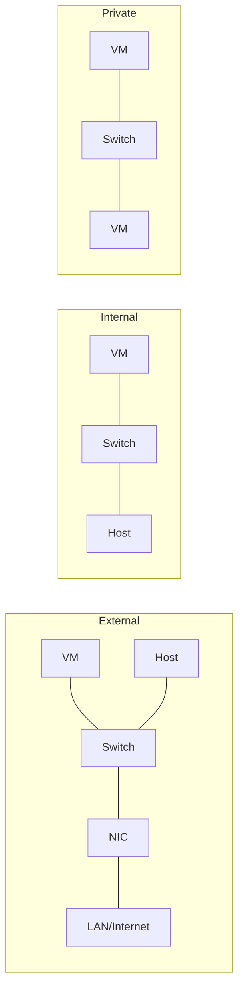

What to notice: the difference is what's on the far side — a NIC (External), the host (Internal), or other VMs (Private).

#### Example scenario
A dev needs an isolated network where VMs talk to each other and the host, but not production → **Internal** switch. Fully sealed lab → **Private**.

#### Commands and tools

```powershell
New-VMSwitch -Name "ExtSW"  -SwitchType External -NetAdapterName "Ethernet0"
New-VMSwitch -Name "IntSW"  -SwitchType Internal
New-VMSwitch -Name "PrivSW" -SwitchType Private
```

#### Exam traps

> **⚠ Exam Trap:** **Internal vs Private** — only difference is whether the host participates.

> **⚠ Exam Trap:** Only **External** requires a physical NIC.

#### Quick check
1. **Q:** Which switch gives VMs internet? **A:** External.
2. **Q:** Internal vs Private difference? **A:** Internal includes the host; Private is VMs only.

### Topic 3 — Checkpoints in Hyper-V

#### Definition
A **checkpoint** (formerly "snapshot") is a saved point-in-time state of a VM (disk, config, optionally memory) that lets you **revert** later.

#### How it works
1. Before a risky change, take a checkpoint.
2. Hyper-V creates a **differencing disk** recording changes after the checkpoint.
3. Revert (apply) returns the VM to that state.
4. Two types: **Standard** (captures memory, crash-consistent) and **Production** (uses guest VSS, application-consistent, no memory).
5. **Checkpoints are NOT backups** — same storage, grow quickly, no host/storage-failure protection.

#### Key terms

| Term | Meaning |
|---|---|
| Checkpoint / snapshot | Point-in-time state of a VM |
| Differencing disk | File recording post-checkpoint changes |
| Revert / Apply | Return to a checkpoint state |
| Production checkpoint | VSS-based, app-consistent, no memory |
| VSS | Volume Shadow Copy Service |

#### Diagram

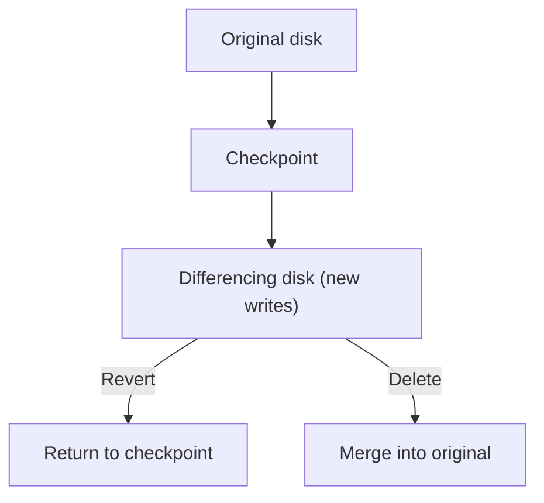

What to notice: after a checkpoint, writes go to a differencing disk; revert discards them, delete merges them.

#### Example scenario
Before a risky patch, take a checkpoint; the patch breaks the app → revert to the pre-patch state in minutes.

#### Commands and tools

```powershell
Checkpoint-VM -Name "Web01" -SnapshotName "Before-Patch"
Get-VMCheckpoint -VMName "Web01"
Restore-VMCheckpoint -VMName "Web01" -Name "Before-Patch"
```

#### Exam traps

> **⚠ Exam Trap:** "A checkpoint is a backup." **Wrong** — short-term rollback point, not failure protection.

> **⚠ Exam Trap:** **Standard vs Production** — Production = VSS/app-consistent, no memory; Standard = memory/crash-consistent.

#### Quick check
1. **Q:** What is a checkpoint for? **A:** Capturing a VM's state to revert after a risky change.
2. **Q:** Why isn't a checkpoint a backup? **A:** Same storage, grows, no host/storage-failure protection.

---

## Storage — 5 topics

### Topic 1 — iSCSI Storage Server

#### Definition
**iSCSI** carries **SCSI storage commands over TCP/IP**. An **iSCSI Storage Server** presents **block-level storage** (LUNs) so a client can attach to remote storage as if it were a local disk.

#### How it works
1. The **target** exposes **LUNs** (logical disks).
2. The **initiator** connects over Ethernet and sees the LUN as a raw local disk.
3. Because it's **block-level**, the *server* formats its own filesystem (NTFS/ReFS).
4. Targets/initiators are identified by an **IQN**.
5. **Role:** builds a **SAN** over standard Ethernet — cheaper than Fibre Channel, ideal for databases/VMs/clustering.

#### Key terms

| Term | Meaning |
|---|---|
| iSCSI | SCSI over TCP/IP |
| Target | Storage server providing LUNs |
| Initiator | Client/server connecting to the target |
| LUN | Logical unit presented to a server |
| IQN | iSCSI Qualified Name — unique identifier |
| Block-level | Raw blocks; server formats its own filesystem |

#### Diagram

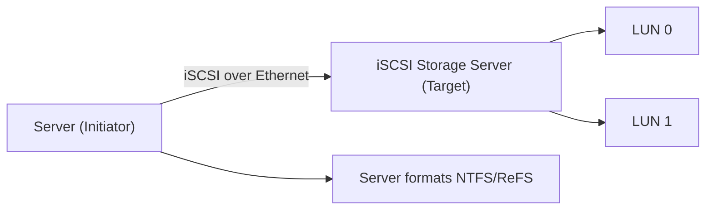

What to notice: initiator connects to target; because it's block-level, the server owns the filesystem.

#### Example scenario
A database team stands up an iSCSI Storage Server; each SQL Server connects as an initiator, formats its LUN with NTFS, and uses it as a local data disk.

#### Commands and tools

```powershell
# Target
Install-WindowsFeature -Name FS-iSCSITarget-Server -IncludeManagementTools
New-IscsiServerTarget -TargetName "SQLTarget"
New-IscsiVirtualDisk -Path "C:\iSCSI\SQLData.vhdx" -Size 200GB
# Initiator
Get-IscsiTarget | Connect-IscsiTarget
```

#### Exam traps

> **⚠ Exam Trap:** **Target vs Initiator** — target provides LUNs; initiator connects. Initiator formats the filesystem.

> **⚠ Exam Trap:** **iSCSI = block-level (SAN), not file-level (NAS).** The server formats its own filesystem.

> **⚠ Exam Trap:** iSCSI runs over **TCP/IP (Ethernet)** — cheaper than Fibre Channel.

#### Quick check
1. **Q:** Target provides what? Initiator does what? **A:** Target provides LUNs; initiator connects and treats them as local disks.
2. **Q:** iSCSI = block or file? **A:** Block-level — server owns the filesystem.

### Topic 2 — Storage Pools

#### Definition
A **Storage Pool** is a group of physical disks aggregated into one pool of capacity; from it you create **Storage Spaces** (virtual disks) with a resiliency level, then volumes.

#### How it works
1. Add disks (any HDD/SSD mix, even different sizes) to a **pool**.
2. Create **Storage Spaces** with a resiliency: **Simple** (no redundancy), **Mirror** (duplicated), **Parity** (stripe + parity).
3. Format each space (NTFS/ReFS) into a volume.
4. **Benefits:** aggregate cheap disks for VMs, grow by adding disks, resilience without hardware RAID, storage tiers (SSD+HDD), thin provisioning.

#### Key terms

| Term | Meaning |
|---|---|
| Storage Pool | Group of physical disks |
| Storage Space | Virtual disk from a pool with a resiliency |
| Resiliency | Simple/Mirror/Parity |
| Tiering | SSD (hot) + HDD (cold) |

#### Diagram

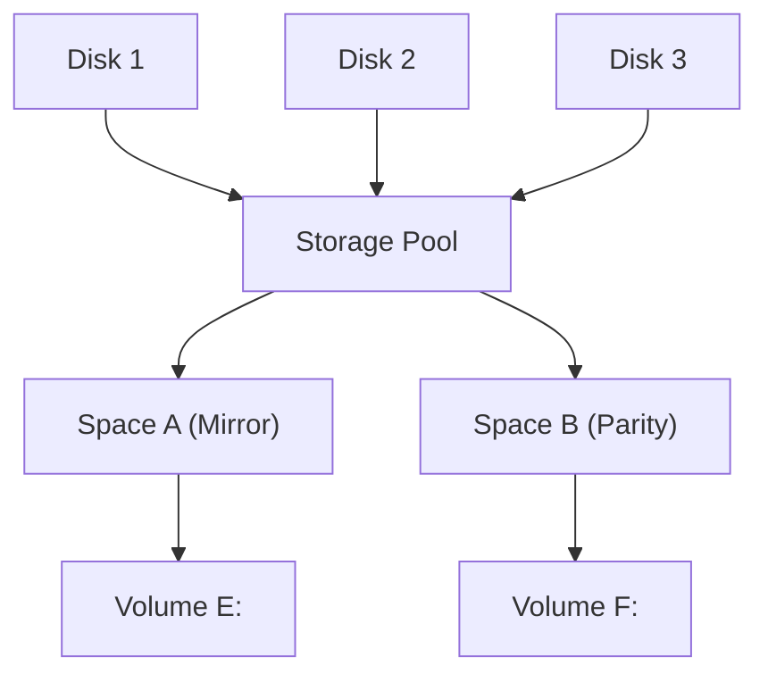

What to notice: disks → pool → spaces → volumes; one pool hosts multiple spaces with different resiliency.

#### Example scenario
Three 1 TB disks in a pool → a Mirrored space for VM boot disks + a Parity space for bulk data, no hardware RAID card.

#### Commands and tools

```powershell
$disks = Get-PhysicalDisk -CanPool $true
New-StoragePool -FriendlyName "Pool1" -StorageSubsystemFriendlyName "Windows Storage*" -PhysicalDisks $disks
New-VirtualDisk -StoragePoolFriendlyName "Pool1" -FriendlyName "MirrorSpace" -ResiliencySettingName Mirror -Size 1TB
```

#### Exam traps

> **⚠ Exam Trap:** **Pool vs Space** — pool = physical disks; space = virtual disk with resiliency.

> **⚠ Exam Trap:** **Simple = no redundancy.** Mirror/Parity survive disk failure.

> **⚠ Exam Trap:** Pools are software-defined — no hardware RAID controller needed.

#### Quick check
1. **Q:** Pool vs space? **A:** Pool = physical disks; space = virtual disk with a resiliency level.
2. **Q:** Three resiliency options? **A:** Simple, Mirror, Parity.

### Topic 3 — RAID (Redundant Array of Independent Disks)

#### Definition
**RAID** combines multiple disks into one logical unit for **performance**, **fault tolerance**, or both. The level (0/1/5/10) defines how data is spread.

#### How it works
1. **RAID 0 (striping)** — split across disks for speed; **no redundancy**.
2. **RAID 1 (mirroring)** — identical copy on two disks; one can fail.
3. **RAID 5 (striping + parity)** — data + parity across 3+ disks; survives one failure.
4. **RAID 10 (1+0)** — mirrored pairs, then striped; needs 4+ disks.

#### RAID comparison table

| Level | Min disks | Fault tolerance | Usable capacity | Best for |
|---|---|---|---|---|
| RAID 0 | 2 | ❌ None | 100% | Scratch/speed |
| RAID 1 | 2 | ✅ 1 disk | 50% | OS/boot, critical data |
| RAID 5 | 3 | ✅ 1 disk | N−1 | General file/data |
| RAID 10 | 4 | ✅ ≥1 (per mirror pair) | 50% | Databases, high-I/O |

#### Diagram

```text
RAID 0 (striping)        RAID 1 (mirror)         RAID 5 (parity, 3 disks)
  D1     D2                D1     D2                D1     D2     D3
 [A1]   [A2]              [A]    [A]               [A1]   [A2]   [Ap]
```

What to notice: RAID 0 has no copy; RAID 1 duplicates; RAID 5 adds parity (survives one failure, costs one disk).

#### Example scenario
A database needs high I/O + redundancy → **RAID 10** (4 disks): mirrors protect, striping delivers speed, at 50% usable.

#### Exam traps

> **⚠ Exam Trap:** **RAID 0 has no redundancy** — never the answer to "which survives a disk failure."

> **⚠ Exam Trap:** **Disk counts** — 0=2, 1=2, 5=**3**, 10=**4**.

> **⚠ Exam Trap:** **Capacity math** — RAID 1/10 = 50%, RAID 5 = N−1, RAID 0 = 100%.

> **⚠ Exam Trap:** RAID is **not a backup** — protects against disk failure only.

#### Quick check
1. **Q:** RAID 5 min disks + failures tolerated? **A:** 3 disks, 1 failure.
2. **Q:** RAID 10 min disks? **A:** 4 disks.

### Topic 4 — Enterprise Storage Solutions: DAS vs NAS vs SAN

#### Definition
Three architectures for connecting storage to servers: **DAS** (direct-attached), **NAS** (file-level over network), **SAN** (block-level over network).

#### How it works
1. **DAS** — storage attached to one server (internal disks, external array). The server owns the disk and filesystem. Simple, cheap, low latency, but **not shared**.
2. **NAS** — a network device serving **files** over SMB/NFS. The NAS owns the filesystem; clients access files. Easy sharing, file-level overhead.
3. **SAN** — **block-level** storage over a dedicated network (Fibre Channel or iSCSI). Servers see LUNs as local disks and format their own filesystem. High performance, shared, scalable.

#### Comparison table

| Feature | DAS | NAS | SAN |
|---|---|---|---|
| Access level | Block (local) | File (SMB/NFS) | Block (iSCSI/FC) |
| Who owns the filesystem | The server | The NAS device | The server |
| Sharing | Single server | Many clients | Multiple servers/cluster |
| Latency | Lowest | Higher | Low |
| Cost | Cheapest | Moderate | Highest |
| Use case | Boot/local data | File shares, archives | Databases, VMs, clustering |

#### Diagram

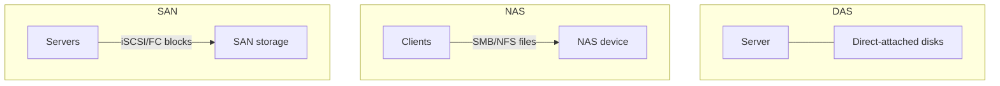

What to notice: DAS = direct; NAS = file shares; SAN = block LUNs over a network.

#### Example scenario
HR needs shared folders for 200 users → **NAS (SMB)**. SQL needs low-latency dedicated storage → **SAN (iSCSI)**. A single server's boot disk → **DAS**.

#### Exam traps

> **⚠ Exam Trap:** **NAS = file-level (SMB/NFS); SAN = block-level (iSCSI/FC).** Don't reverse them.

> **⚠ Exam Trap:** **DAS vs SAN** — DAS attaches to one server; SAN is shared block storage over a network.

> **⚠ Exam Trap:** With **block** (DAS/SAN), the server owns the filesystem; with **file** (NAS), the device owns it.

#### Quick check
1. **Q:** Which serves files over SMB/NFS? **A:** NAS.
2. **Q:** Which is block-level and shared? **A:** SAN.

### Topic 5 — Storage Layout & Disk Requirements

#### Definition
Planning a storage configuration — choosing the RAID level, disk count, and capacity to satisfy performance, redundancy, and cost requirements.

#### How it works
1. **Minimum disk requirements:** RAID 0 = 2, RAID 1 = 2, RAID 5 = 3, RAID 10 = 4.
2. **Usable capacity:** RAID 0 = N (100%), RAID 1 = 50%, RAID 5 = N−1, RAID 10 = 50%.
3. **Matching enterprise need:** OS/boot → RAID 1; database/high-IO → RAID 10; general file/data → RAID 5; scratch/speed-only → RAID 0.
4. **Planning factors:** performance (IOPS/throughput), fault tolerance, capacity, cost, and hot-spare disks.

#### Key terms

| Term | Meaning |
|---|---|
| Minimum disk count | Fewest disks a RAID level requires |
| Usable capacity | Logical space after redundancy overhead |
| Fault tolerance | Ability to survive disk failure |
| IOPS | I/O operations per second (performance) |
| Hot spare | Standby disk that auto-replaces a failed one |

#### Diagram

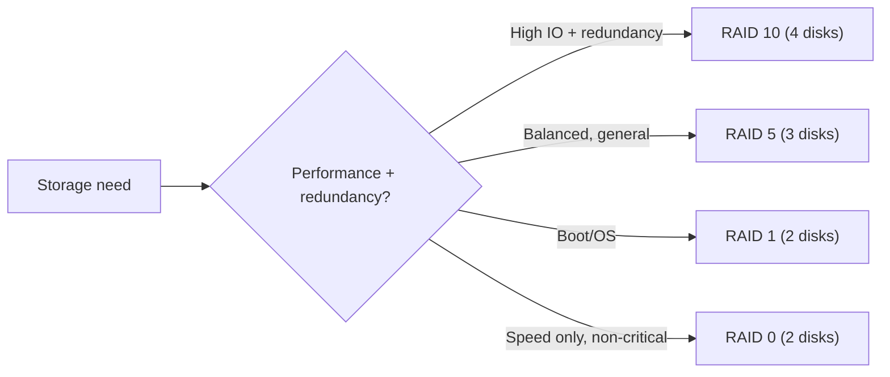

What to notice: the RAID choice flows from the requirement — redundancy vs performance vs capacity.

#### Example scenario
A file server needs balanced capacity + one-disk fault tolerance on a budget → **RAID 5** (3 disks). A database needs high IOPS + redundancy → **RAID 10** (4 disks).

#### Exam traps

> **⚠ Exam Trap:** **Minimum disk counts** — RAID 5 needs **3**, RAID 10 needs **4**. "Which needs a minimum of 3 disks?" → RAID 5.

> **⚠ Exam Trap:** **Usable capacity** — "4 × 2 TB in RAID 5 = ?" → **6 TB** (N−1).

> **⚠ Exam Trap:** "More disks always = more redundancy." **Wrong** — RAID 0 adds disks but zero fault tolerance.

#### Quick check
1. **Q:** Minimum disks for RAID 5 and RAID 10? **A:** RAID 5 = 3, RAID 10 = 4.
2. **Q:** 4 × 2 TB in RAID 5 — usable? **A:** 6 TB (N−1 = 3 disks' worth).
