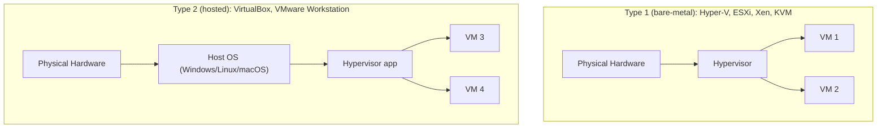
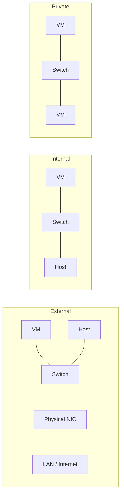
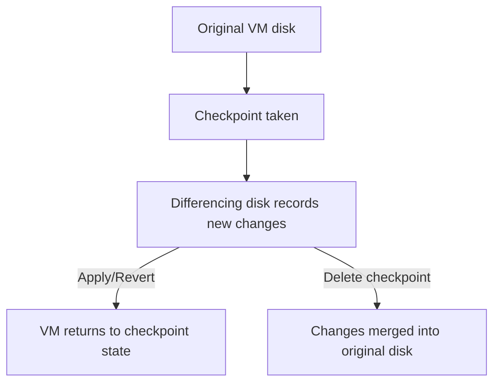

# Hyper-V & Hypervisors — Midterm Notes

> **💡 Key Idea:** Three topics here: **what Hyper-V is** (and the Type 1 vs Type 2 split), the **three
> virtual switch types**, and **checkpoints**. The exam tests these as "which type/which switch/which
> scenario" decisions, so focus on the *differences* and *use cases*.

## Concept cheat-sheet: easily-confused pairs

| Concept A | Concept B | The distinction that matters |
|---|---|---|
| **Type 1 hypervisor** | **Type 2 hypervisor** | Type 1 runs **directly on hardware** (bare-metal); Type 2 runs **on top of a host OS**. |
| **External switch** | **Internal switch** | External binds a **physical NIC** (VMs reach LAN/internet); Internal connects **VMs + host only**. |
| **Internal switch** | **Private switch** | Internal includes the **host**; Private is **VMs-only** (host excluded). |
| **Standard checkpoint** | **Production checkpoint** | Standard captures **memory + state** (crash-consistent); Production uses **VSS** in the guest (application-consistent, like a backup). |
| **Checkpoint** | **Backup** | A checkpoint is a short-term **rollback point**, not protection against host/storage failure. |

---

## Topic 1 — What is Hyper-V? (and hypervisor types)

### Definition
**Hyper-V** is Microsoft's built-in **hypervisor** (virtualization technology) for Windows Server and Windows client, which lets you run multiple isolated **virtual machines** on a single physical host, each with its own virtual CPU, memory, disk, and OS.

### How it works
1. The **hypervisor** sits between the physical hardware and the guest OSes, scheduling vCPUs and mapping virtual memory/disk to physical resources.
2. Each VM gets **virtual hardware** (vCPU, virtual RAM, a virtual disk file like `.vhdx`) that the guest OS sees as real.
3. Hyper-V is a **Type 1 (bare-metal)** hypervisor: enabling it installs the hypervisor *beneath* Windows, so even on a Windows client the OS runs *under* the hypervisor.
4. **Type 2 (hosted)** hypervisors (VirtualBox, VMware Workstation) instead run as an *application* on a normal host OS.

### Key terms

| Term | Meaning |
|---|---|
| Hypervisor | The software layer that creates and runs VMs |
| VM | A software emulation of a physical computer |
| Guest OS | The OS running inside a VM |
| Host | The physical machine (and, for Type 2, its OS) |
| Bare-metal | Running directly on hardware with no host OS |
| `.vhdx` | Hyper-V virtual disk file format |

### Diagram



What to notice: **Type 1 talks directly to hardware** (the hypervisor *is* the OS layer); **Type 2 goes through a host OS**. This is why Type 1 is more efficient and more secure, and Type 2 is more convenient on a desktop.

### Example scenario
An IT department needs to run 10 server workloads but has only 2 physical machines. They install **Hyper-V (Type 1)** on both hosts and carve each into 5 VMs — saving hardware, power, and space while keeping workloads isolated.

### Commands and tools

```powershell
# Enable the Hyper-V role on a Windows Server host
Install-WindowsFeature -Name Hyper-V -IncludeManagementTools -Restart
Get-VM                    # list VMs
New-VM -Name "Web01" -MemoryStartupBytes 4GB -NewVHDPath "C:\VMs\Web01.vhdx" -NewVHDSizeBytes 80GB
```

GUI: **Server Manager → Manage → Add Roles and Features → Hyper-V**, then **Hyper-V Manager**.

### Exam traps

> **⚠ Exam Trap:** "Hyper-V on Windows 10/11 is Type 2 because Windows is still installed." **Wrong** — enabling Hyper-V makes Windows run *under* the Hyper-V hypervisor, so it's still **Type 1**.

> **⚠ Exam Trap:** **Hypervisor vs VM.** The hypervisor *creates/manages* VMs; the VM is the *guest computer*. "Which component schedules vCPUs?" → the hypervisor.

> **⚠ Exam Trap:** Type 1's advantages are **performance, isolation, and security** (no host-OS layer); Type 2's advantage is **convenience** (easy install on any desktop). Don't claim Type 2 is faster.

### Quick check
1. **Q:** Classify Hyper-V, ESXi, VirtualBox, and VMware Workstation as Type 1 or Type 2. **A:** Hyper-V and ESXi = Type 1; VirtualBox and VMware Workstation = Type 2.
2. **Q:** Why is a Type 1 hypervisor generally preferred in production? **A:** Better performance and stronger isolation/security because it runs directly on hardware with no intervening host OS.

---

## Topic 2 — Hyper-V Virtual Switches (Internal, External, Private)

### Definition
A **virtual switch** connects VMs to networks. Hyper-V offers three types that differ by **what they connect**: the physical network, the host, or only other VMs.

### How it works
1. **External switch** — binds to a **physical NIC**. VMs reach the physical LAN/internet, and the host optionally shares that NIC. Use when VMs need real network access (production).
2. **Internal switch** — connects **VMs to each other and to the host**, but has **no physical NIC** (no external access). Often paired with **NAT** on the host for outbound internet. Use for host↔VM communication and isolated-but-manageable networks.
3. **Private switch** — connects **VMs only**; even the host is excluded. Use for maximum isolation (a sealed lab or DMZ-internal segment).

### Key terms

| Term | Meaning |
|---|---|
| Virtual switch | A software-defined Layer-2 switch in Hyper-V |
| Physical NIC | The host's real network adapter |
| NAT | Network Address Translation (applied to an Internal switch for internet) |

### Comparison table

| Switch type | VM ↔ VM | VM ↔ Host | VM ↔ Physical network |
|---|---|---|---|
| **External** | ✅ | ✅ (host shares NIC) | ✅ |
| **Internal** | ✅ | ✅ | ❌ |
| **Private** | ✅ | ❌ | ❌ |

### Diagram



What to notice: the difference is **what sits on the far side of the switch** — a physical NIC (External), the host only (Internal), or just other VMs (Private).

### Example scenario
A developer needs an isolated test network where VMs can talk to each other **and** to the admin's host (to copy files) but must **not** touch the production LAN — they create an **Internal** switch. For a fully sealed lab, they'd use a **Private** switch.

### Commands and tools

```powershell
New-VMSwitch -Name "ExtSW"  -SwitchType External -NetAdapterName "Ethernet0"
New-VMSwitch -Name "IntSW"  -SwitchType Internal
New-VMSwitch -Name "PrivSW" -SwitchType Private
Get-VMSwitch
```

GUI: **Hyper-V Manager → Virtual Switch Manager → New virtual network switch**.

### Exam traps

> **⚠ Exam Trap:** **Internal vs Private** — the only difference is whether the **host** participates. "Which switch lets VMs talk to the host but not the LAN?" → **Internal**. "Which excludes the host?" → **Private**.

> **⚠ Exam Trap:** "External removes the host from the network." **Wrong** — an External switch *shares* the physical NIC with the host (you can disable host sharing, but by default the host stays connected).

> **⚠ Exam Trap:** Only the **External** switch requires a **physical NIC**. Internal and Private have no physical adapter.

### Quick check
1. **Q:** Which switch type gives VMs internet access? **A:** External (bound to a physical NIC).
2. **Q:** What is the single difference between Internal and Private? **A:** Internal includes the host; Private connects VMs only.

---

## Topic 3 — Checkpoints in Hyper-V

### Definition
A **checkpoint** (formerly "snapshot") is a saved **point-in-time state** of a virtual machine — its disk, configuration, and (optionally) memory — that lets you **revert** the VM back to that exact state later.

### How it works
1. Before a risky change (patch, software install, config change), you **take a checkpoint**.
2. Hyper-V creates a **differencing disk** that records all changes *after* the checkpoint, leaving the original disk untouched.
3. If something goes wrong, you **Apply/Revert** the checkpoint to return the VM to its pre-change state.
4. Two checkpoint types:
   - **Standard checkpoint** — captures the full state including **memory**, like pausing the VM; "crash-consistent" (not application-aware).
   - **Production checkpoint** — uses **VSS inside the guest** to create an **application-consistent** snapshot (like a backup); does **not** capture memory.
5. **Checkpoints are NOT backups** — they live on the same storage, grow quickly, and offer no protection if the host/storage fails.

### Key terms

| Term | Meaning |
|---|---|
| Checkpoint / snapshot | A saved point-in-time state of a VM |
| Differencing disk | A file recording changes made after a checkpoint |
| Revert / Apply | Returning the VM to a checkpoint's state |
| Standard checkpoint | Captures memory + state (crash-consistent) |
| Production checkpoint | Uses guest VSS (application-consistent, no memory) |
| VSS | Volume Shadow Copy Service — coordinates app-consistent snapshots |

### Diagram



What to notice: after a checkpoint, **new writes go to a differencing disk**; reverting discards them, and deleting a checkpoint **merges** them back into the original disk.

### Example scenario
Before applying a critical security patch to a production web server VM, an admin takes a **checkpoint**. The patch breaks the app, so the admin **reverts** the checkpoint and the VM returns to its pre-patch, working state in minutes.

### Commands and tools

```powershell
Checkpoint-VM -Name "Web01" -SnapshotName "Before-Patch"   # take a checkpoint
Get-VMCheckpoint -VMName "Web01"                           # list checkpoints
Restore-VMCheckpoint -VMName "Web01" -Name "Before-Patch"  # revert
Remove-VMCheckpoint -VMName "Web01" -Name "Before-Patch"   # delete (merges)
```

GUI: **Hyper-V Manager → right-click VM → Checkpoint**; manage under the VM's **Checkpoints** pane.

### Exam traps

> **⚠ Exam Trap:** "A checkpoint is a backup." **Wrong** — checkpoints are short-term **rollback points** on the same storage; they don't protect against host/storage failure and degrade performance if left to accumulate.

> **⚠ Exam Trap:** **Standard vs Production checkpoint.** Production checkpoints use **guest VSS** (application-consistent) and don't capture memory; Standard checkpoints capture memory (crash-consistent). "Which checkpoint type is application-aware?" → Production.

> **⚠ Exam Trap:** Leaving many checkpoints **grows the differencing disk** and slows the VM. Best practice: delete checkpoints once you're confident in the change.

### Quick check
1. **Q:** What is a checkpoint used for? **A:** To capture a VM's point-in-time state so you can revert after a risky change.
2. **Q:** Why are checkpoints not a backup strategy? **A:** They live on the same storage, grow quickly, and don't protect against host/storage failure.
