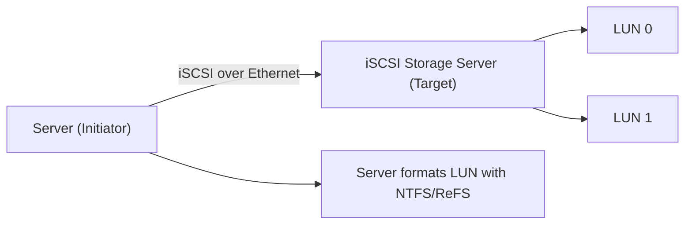
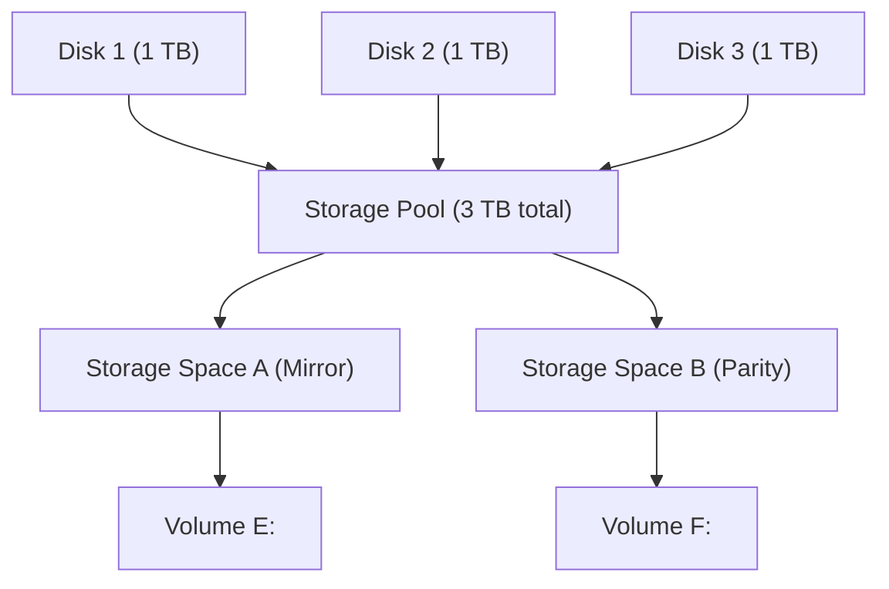

# Storage: iSCSI, Storage Pools & RAID — Midterm Notes

> **💡 Key Idea:** Three topics: **iSCSI** (block storage over the network), **storage pools** (software-defined
> disk aggregation), and **RAID** (disk redundancy/performance). RAID is the most likely to be tested with
> exact numbers — know the **minimum disk count and fault tolerance of every level**.

## Concept cheat-sheet: easily-confused pairs

| Concept A | Concept B | The distinction that matters |
|---|---|---|
| **iSCSI target** | **iSCSI initiator** | The **target** *provides* the disks/LUNs; the **initiator** *connects to* them. |
| **iSCSI (SAN)** | **NAS** | iSCSI presents **block-level** storage (server formats its own filesystem); NAS presents **file-level** shares (SMB/NFS). |
| **Storage Pool** | **Storage Space** | A pool is the **group of physical disks**; a space is the **virtual disk** carved from the pool. |
| **RAID 0** | **RAID 1** | RAID 0 = **striping, no redundancy** (speed); RAID 1 = **mirroring** (redundancy). |
| **RAID 5** | **RAID 10** | RAID 5 = striping + **parity** (min 3 disks, 1-disk fault tolerance); RAID 10 = **mirror + stripe** (min 4 disks, faster, more expensive). |

---

## Topic 1 — iSCSI Storage Server

### Definition
**iSCSI** (Internet Small Computer System Interface) is a protocol that carries **SCSI storage commands over TCP/IP networks**. An **iSCSI Storage Server** presents **block-level storage** (disks/LUNs) to servers over the network, so a client can attach to remote storage as if it were a local disk.

### How it works
1. The **iSCSI target** (storage server) exposes one or more **LUNs** (logical units — essentially virtual disks).
2. The **iSCSI initiator** (the client/server) connects to the target over Ethernet and sees the LUN as a raw **local disk**.
3. Because it's **block-level**, the *server* (initiator) creates and owns the **filesystem** (NTFS/ReFS) on that disk.
4. Each target/initiator is identified by an **IQN** (iSCSI Qualified Name) — a unique, permanent name.
5. **Role in enterprise storage:** iSCSI builds a **SAN (Storage Area Network)** over standard Ethernet — cheaper than Fibre Channel, reuses the existing IP network, and gives low-latency block access ideal for **databases, VMs, and failover clustering**.

### Key terms

| Term | Meaning |
|---|---|
| iSCSI | SCSI commands encapsulated over TCP/IP (Ethernet) |
| Target | The storage server that provides the LUNs |
| Initiator | The client/server that connects to the target |
| LUN | Logical Unit Number — a block device presented to a server |
| IQN | iSCSI Qualified Name — unique identifier for target/initiator |
| Block-level | Raw blocks; the server formats its own filesystem |

### Diagram



What to notice: the **initiator** connects to the **target** over the network, and because it's **block-level**, the *server* — not the storage device — owns the filesystem.

### Example scenario
A database team needs low-latency, dedicated storage without buying a Fibre Channel SAN. They stand up an **iSCSI Storage Server**, and each SQL Server connects as an **initiator**, formats its LUN with NTFS, and uses it as a local disk for data files.

### Commands and tools

```powershell
# On the target: install the iSCSI Target Server role
Install-WindowsFeature -Name FS-iSCSITarget-Server -IncludeManagementTools
New-IscsiServerTarget -TargetName "SQLTarget"
New-IscsiVirtualDisk -Path "C:\iSCSI\SQLData.vhdx" -Size 200GB

# On the initiator: discover and connect
Get-IscsiTarget | Connect-IscsiTarget
Get-Disk | Where-Object IsOffline -eq $true | Set-Disk -IsOffline $false
```

GUI: **Server Manager → File and Storage Services → iSCSI** (target); **iSCSI Initiator** control panel (client).

### Exam traps

> **⚠ Exam Trap:** **Target vs Initiator.** The target *provides*, the initiator *connects*. "Which side presents the LUNs?" → target. "Which side formats the filesystem?" → the initiator (the server).

> **⚠ Exam Trap:** **iSCSI = block-level (SAN), not file-level (NAS).** The server formats its own filesystem. Don't say iSCSI "serves files over SMB" — that's a NAS.

> **⚠ Exam Trap:** iSCSI runs over **TCP/IP (Ethernet)**, which is why it's cheaper than Fibre Channel SANs. Don't claim iSCSI requires Fibre Channel hardware.

### Quick check
1. **Q:** What does the iSCSI target provide, and what does the initiator do? **A:** The target provides the LUNs; the initiator connects to them and treats them as local disks.
2. **Q:** Is iSCSI block-level or file-level storage? **A:** Block-level — the server formats its own filesystem on the LUN.

---

## Topic 2 — Storage Pools

### Definition
A **Storage Pool** is a group of physical disks aggregated into a single pool of raw capacity. From that pool you create **Storage Spaces** (virtual disks) with a chosen resiliency level, which you then format into volumes.

### How it works
1. Add physical disks (any mix of HDD/SSD, even different sizes) to a **Storage Pool** — Windows **Storage Spaces** manages them.
2. From the pool, create **Storage Spaces** (virtual disks), each with a **resiliency** setting:
   - **Simple** — striping only, no redundancy (fast, but one disk failure = data loss).
   - **Mirror** — data duplicated (2-way or 3-way), high resilience.
   - **Parity** — striping with parity, efficient redundancy (like RAID-5).
3. Format each space (NTFS/ReFS) into a **volume**.
4. **Benefits in virtualization:** aggregate many cheap disks into a large, expandable store for VMs; add capacity by adding disks; get resilience without a hardware RAID controller; enable **storage tiers** (SSD + HDD) and **thin provisioning**.

### Key terms

| Term | Meaning |
|---|---|
| Storage Pool | A group of physical disks managed as one capacity pool |
| Storage Space | A virtual disk created from a pool, with a resiliency level |
| Resiliency | How a space survives disk failure (Simple/Mirror/Parity) |
| Tiering | Combining SSD (hot) + HDD (cold) tiers for performance/cost |
| Thin provisioning | Allocating capacity on demand |

### Diagram



What to notice: the chain is **disks → pool → spaces → volumes**. One pool can host **multiple spaces** with **different resiliency** settings.

### Example scenario
A virtualization host has three 1 TB disks. The admin puts all three in a **Storage Pool**, creates a **Mirrored Storage Space** for VM boot disks and a **Parity Space** for bulk data — gaining resilience without a hardware RAID card, and adding disks later to grow capacity.

### Commands and tools

```powershell
$disks = Get-PhysicalDisk -CanPool $true
New-StoragePool -FriendlyName "Pool1" -StorageSubsystemFriendlyName "Windows Storage*" -PhysicalDisks $disks
New-VirtualDisk -StoragePoolFriendlyName "Pool1" -FriendlyName "MirrorSpace" -ResiliencySettingName Mirror -Size 1TB
Get-StoragePool; Get-VirtualDisk
```

GUI: **Server Manager → File and Storage Services → Storage Pools**.

### Exam traps

> **⚠ Exam Trap:** **Pool vs Space.** The **pool is the physical disks**; the **space is the virtual disk**. "Which aggregates physical disks?" → pool. "Which has a resiliency setting?" → space.

> **⚠ Exam Trap:** **Simple = no redundancy.** "Which resiliency survives a disk failure?" → **Mirror or Parity**, never Simple.

> **⚠ Exam Trap:** Storage Pools (Windows Storage Spaces) are **software-defined** — they replace/augment hardware RAID, so you don't need a dedicated RAID controller. Don't say a pool requires hardware RAID.

### Quick check
1. **Q:** What is the difference between a storage pool and a storage space? **A:** A pool is the group of physical disks; a space is the virtual disk created from that pool with a resiliency level.
2. **Q:** Name the three Storage Spaces resiliency options. **A:** Simple, Mirror, and Parity.

---

## Topic 3 — RAID (Redundant Array of Independent Disks)

### Definition
**RAID** combines multiple physical disks into a single logical unit to improve **performance**, **fault tolerance**, or both. The level (0, 1, 5, 10) defines how data is spread — striped, mirrored, or parity-protected.

### How it works
1. **RAID 0 (striping)** — data is split across disks for speed. **No redundancy**; any disk failure destroys the array.
2. **RAID 1 (mirroring)** — data is written identically to **two** disks. Full redundancy (one disk can fail).
3. **RAID 5 (striping + parity)** — data and **parity** are striped across **3+** disks. Survives **one** disk failure; parity is recomputed from the survivors.
4. **RAID 10 (1+0)** — **mirrored pairs** are then **striped** together. Combines RAID 1's redundancy with RAID 0's speed; needs **4+** disks.

### Key terms

| Term | Meaning |
|---|---|
| Striping | Splitting data across multiple disks for speed |
| Mirroring | Duplicating data to a second disk |
| Parity | Redundant math data that lets a failed disk be reconstructed |
| Fault tolerance | The ability to survive disk failure |
| Usable capacity | The logical space remaining after redundancy overhead |

### RAID comparison table

| Level | Min disks | Fault tolerance | Usable capacity | Performance | Best for |
|---|---|---|---|---|---|
| **RAID 0** | 2 | ❌ None (any disk = total loss) | 100% (N disks) | Fastest (reads + writes) | Scratch/temp, non-critical speed |
| **RAID 1** | 2 | ✅ 1 disk | 50% (1 disk) | Fast reads, normal writes | OS/boot, critical small data |
| **RAID 5** | 3 | ✅ 1 disk | N−1 disks | Fast reads, slower writes (parity) | General file/data, balanced |
| **RAID 10** | 4 | ✅ ≥1 (one per mirror pair) | 50% | Fastest + redundant | Databases, high-I/O, VMs |

### Diagram

```text
RAID 0 (striping, 2 disks)        RAID 1 (mirroring, 2 disks)
  Disk1   Disk2                     Disk1   Disk2
  [A1]    [A2]                      [A]     [A]
  [B1]    [B2]                      [B]     [B]
  (A split across 2)                (A duplicated)

RAID 5 (parity, 3 disks)          RAID 10 (mirror + stripe, 4 disks)
  D1      D2      D3                 Pair1          Pair2
  [A1]    [A2]    [Ap]             D1    D2      D3    D4
  [B1]    [Bp]    [B2]             [A]   [A]     [A1]  [A2]
  (parity rotates across disks)     (mirrored, then striped)
```

What to notice: RAID 0 splits data for speed but has **no copy**; RAID 1 keeps a **full duplicate**; RAID 5 adds **parity** (survives one failure, costs one disk of capacity); RAID 10 **mirrors then stripes**.

### Example scenario
A database needs both high I/O and redundancy. The admin chooses **RAID 10** (4 disks): the mirrors protect against a disk failure, and the striping delivers high performance — at the cost of 50% usable capacity.

### Commands and tools

```powershell
# Hardware RAID is configured in the controller BIOS/utility.
# For software-level equivalents, dynamic disks / Storage Spaces:
# RAID-0-like:  New-VirtualDisk -ResiliencySettingName Simple
# RAID-1-like:  New-VirtualDisk -ResiliencySettingName Mirror
# RAID-5-like:  New-VirtualDisk -ResiliencySettingName Parity
```

GUI: **Disk Management** (dynamic disk RAID-0/1/5) or **Storage Spaces** (Simple/Mirror/Parity).

### Exam traps

> **⚠ Exam Trap:** **RAID 0 has no redundancy** — "which RAID survives a disk failure?" is never RAID 0. RAID 0 is *speed only*.

> **⚠ Exam Trap:** **Disk counts** are the classic test point: RAID 0 = 2, RAID 1 = 2, RAID 5 = **3**, RAID 10 = **4**. "Which level needs a minimum of 3 disks?" → RAID 5.

> **⚠ Exam Trap:** **Capacity math** — RAID 1 and RAID 10 give **50%** usable; RAID 5 gives **N−1**; RAID 0 gives **100%** (but no safety). "4 × 1 TB in RAID 5 = ?" → **3 TB** usable.

> **⚠ Exam Trap:** **RAID is not a backup** — it protects against *disk* failure, not accidental deletion, corruption, or site disaster. Don't claim RAID replaces backups.

### Quick check
1. **Q:** What is the minimum number of disks for RAID 5, and how many can fail? **A:** 3 disks minimum; tolerates 1 disk failure.
2. **Q:** Which RAID level combines mirroring and striping, and what is its minimum disk count? **A:** RAID 10 — minimum 4 disks.
